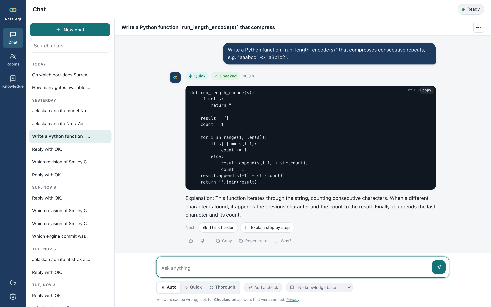
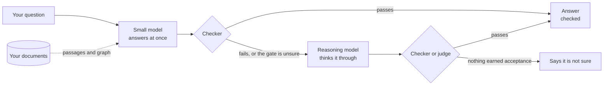
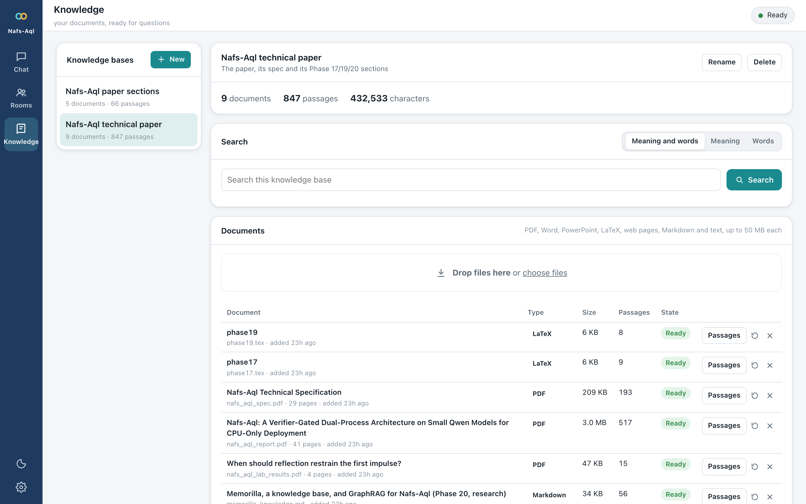
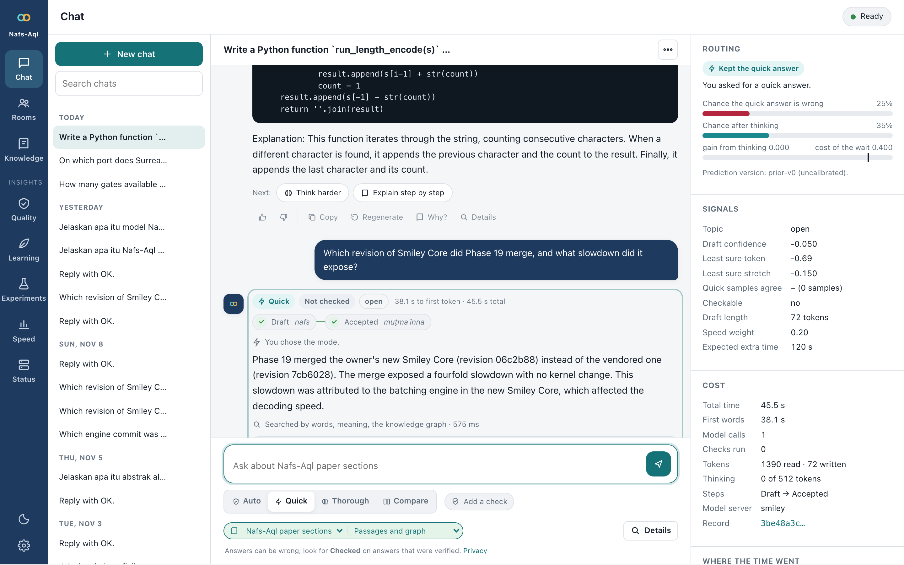
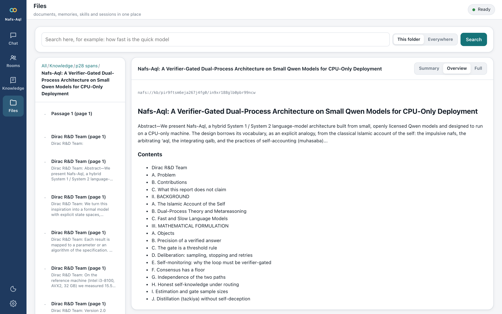
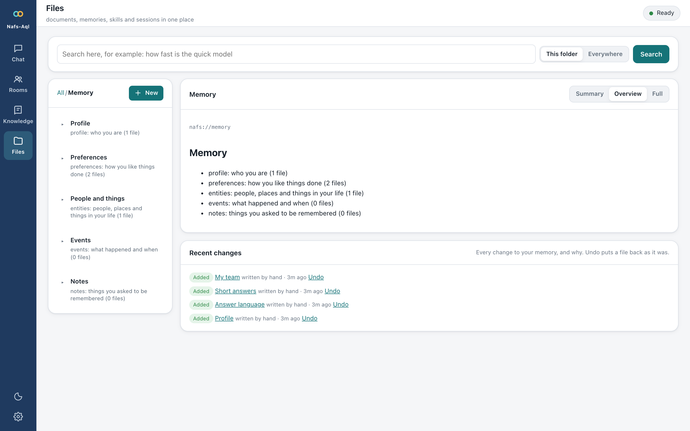
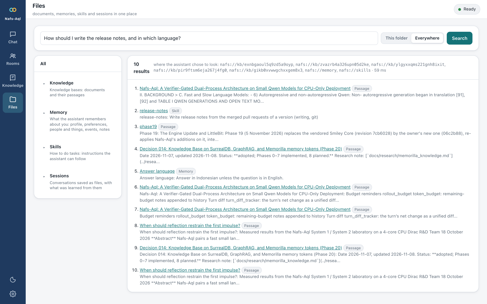
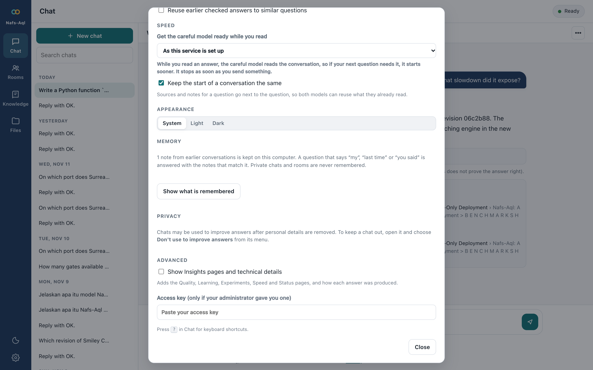
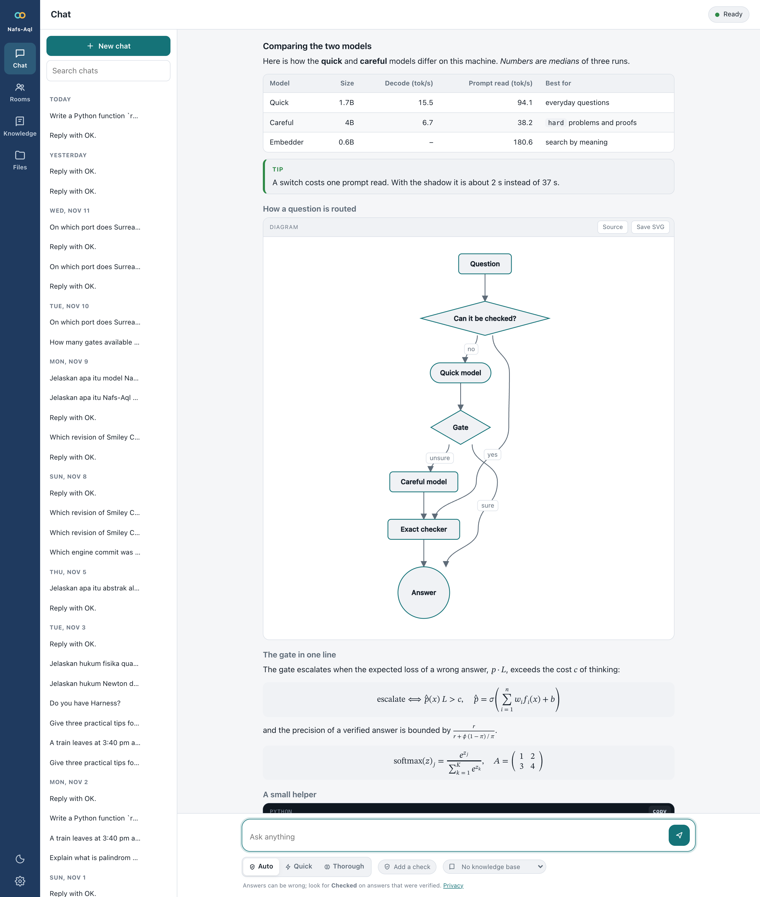
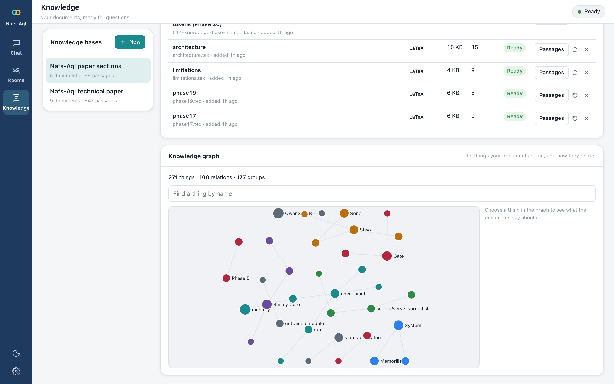

<div align="center">

# Nafs-Aql

### Fast when it can. Careful when it must.

**An AI assistant that runs on four CPU cores, answers from your own documents, and tells you when it is not sure.**

Built by the [Dirac](https://dirac.id) R&D Team.

[](https://github.com/rismanmattotorang/nafsaql/actions/workflows/ci.yml)
[](LICENSE)
[](docs/features_and_results.md)
[](rust/)

[The problem](#the-problem) · [The product](#the-product) · [Proof](#proof) · [Quick start](#quick-start) · [How it works](#how-it-works) · [Docs](docs/index.md)

<br>



</div>

---

## The problem

Small models are fast and wrong too often. Large models are careful and need a GPU or someone else's servers.
Neither tells you which of its answers to trust.

## The product

**01 — Checked, or "Not sure".** A small model answers at once. A reasoning model steps in only when the question is worth the wait. Where an answer can be checked (maths, code against tests, data against a schema), a checker decides, not the model. Every answer is labelled *Checked*, *Cross-checked* or *Not checked*.

**02 — Your documents, with sources.** Drop in PDF, Word, PowerPoint, LaTeX, web pages or notes. Ask in plain language. Every claim points at the passage that states it, the answer says which of its sentences are *not* in those passages, and a map shows what your documents talk about.

**03 — It remembers, and shows what it remembers.** Tell it something in one chat and ask in another. What you say about yourself ("call me …", "I prefer …", "my manager is …", "remember that …") becomes a memory file you can read, edit and delete, every change is logged and can be undone, and your preferences apply to every answer. Private chats and rooms are never remembered.

**04 — Everything in one place.** Documents, memories, skills and saved chats live in one tree with an address for each (`nafs://…`). Every folder and document has a one-line summary and an overview made without a model, a search can stay inside one folder, and a library can be compiled into a wiki, a map of its terms or a report.

**05 — The careful model is ready when you need it.** While you read an answer, the reasoning model reads the conversation, so when your next question needs it, it starts in about 2 seconds instead of 37. Sending a message stops it at once; Settings → Speed turns it off.

**06 — Four CPU cores.** No GPU. No API key. Nothing leaves your machine.

## Proof

Measured on one shared 4-core Intel i3-8100. Every figure comes from a stored run in [`benchmarks/`](benchmarks/).

| | |
|---|---|
| **36 %** | of the cost of always reasoning, at the same accuracy on hard questions |
| **0.15 s** | to search 847 passages by words and meaning together; the search itself takes 0.2 ms, the rest is reading the question |
| **18 of 20** | held-out questions answered with passages, against 2 of 20 without |
| **38 of 44** | answers made up without reading are flagged by the check against the passages; it flags 1 of 42 right ones, and it cannot catch a wrong number taken from the right passage |
| **+23 %** | faster reading of a prompt, by reading with all four cores and writing with three; an answer from documents arrives 16 % sooner |
| **10×** | as often does a follow-up question ("and how fast is it?") find its passage first, when it is read with the question before it |
| **14 of 14** | live checks of the memory pass: a fact is found from another chat by its words or its meaning, and is gone when you forget it |

The rest, including what did not work, is in [features and measured results](docs/features_and_results.md).

## Quick start

You need Rust 1.96+, Python 3.10+ and about 4 GB of disk.

```bash
git clone https://github.com/rismanmattotorang/nafsaql.git && cd nafsaql
```

```bash
make models
```

```bash
make up
```

Open **http://127.0.0.1:8080**. `make down` stops everything. Other ways to serve it: [serving and operations](docs/serving_and_operations.md).

## How it works



The gate escalates only when the error it expects to save is worth the waiting time. Where a checker exists its verdict is final; agreement between samples is a hint, never proof.

## Ask your documents

<table>
<tr>
<td width="50%"><br><sub><b>Your library.</b> Searchable by its words seconds after upload, by meaning soon after.</sub></td>
<td width="50%"><br><sub><b>Answers with sources.</b> Click a number to read the passage.</sub></td>
</tr>
<tr>
<td width="50%"><br><sub><b>One place for everything.</b> A document opens at its overview: sections, tables, key terms.</sub></td>
<td width="50%"><br><sub><b>Memory you can edit.</b> Every change is listed with its reason, and can be undone.</sub></td>
</tr>
<tr>
<td width="50%"><br><sub><b>Search everything, or one folder.</b> Documents, memories and skills in one result list.</sub></td>
<td width="50%"><br><sub><b>Ready when you need it.</b> The careful model reads the conversation while you read the answer.</sub></td>
</tr>
<tr>
<td colspan="2"><br><sub><b>Answers drawn as you read them.</b> Tables, formulas, diagrams and code are rendered, with copy buttons; unfinished ones stay plain text until they close.</sub></td>
</tr>
<tr>
<td colspan="2"><br><sub><b>A map of your documents.</b> Drawn from the text the moment a file is read; a deeper pass adds relations, each with the sentence that states it.</sub></td>
</tr>
</table>

PDFs are read by their layout, not line by line: two-column papers come out in reading order, section titles become headings that every passage carries, tables stay as rows, and running headers and page numbers are dropped, with no model and no extra download (166 of 173 section titles found, against 11 before; 15 ms a page). Each passage is also searched by its sentences, so a question about one fact finds the passage that states it (answer first for 88 % of quoted questions, against 77 % before). Search runs in memory, beside the store that keeps your files, so it does not slow down when the machine is busy. A typing slip in a question is matched to the nearest word your documents contain, and a follow-up such as "and how fast is it?" is searched together with the question before it. Reading a file again only re-reads what changed. Uploads are capped and checked, and deleting a library removes what was derived from it. Details: [Knowledge specification](docs/spec/knowledge_base_spec.md), its [search update](docs/spec/knowledge_sota_spec.md), [how it compares with vLLM Semantic Router and Memorilla](docs/research/router_memory_gaps.md), [what was taken from LiteParse and semtools](docs/research/liteparse_semtools_gaps.md), and [the context filesystem, after OpenViking](docs/spec/context_fs_spec.md).

## Status

A research preview, built in the open, running end to end on a CPU today. Current release: **0.1.0** ([notes](docs/release/RELEASE-0.1.0.md)).

- **Open:** questions worded differently from the document are found in the first eight passages only a quarter of the time. The remedies need larger models than this release ships.
- **Not done:** the release-scale evaluation, the first distillation cycle and the pre-training of the memory-token module need a faster machine. The learned gate waits for its ledger: 1,294 of the 2,900 checked answers it asks for.
- **Did not work, and published:** speculative decoding, 1-bit weights, concurrent hedging, a larger embedding model, score-based fusion, a graph arm in everyday search, guessing a question's difficulty before answering it, cache-blocking the engine's prompt reading, a summaries-first knowledge prompt (it lost answers at the same size), guessing which document a question is about, warming the careful model while the quick one drafts (every quick answer 75 % slower). A shorter knowledge prompt is 20 to 26 % faster and is left off: it cost 3 right answers in 50.

Current state: [docs/roadmap/STATUS.md](docs/roadmap/STATUS.md).

## Documentation

| | |
|---|---|
| [User guide](docs/user_guide.md) | the app, rooms, the lab, your documents |
| [Paper](docs/report/nafs_aql_report.pdf) | the formal model and its proofs, the architecture, every measurement |
| [Features and measured results](docs/features_and_results.md) | everything built, with evidence, and how it compares |
| [Answer rendering](docs/decisions/024-rich-answers-and-graph-phase31.md) | tables, maths, diagrams and code, and the knowledge graph |
| [Context filesystem](docs/spec/context_fs_spec.md) · [ShadowPrefill](docs/spec/shadow_prefill_spec.md) | one place for documents, memory, skills and chats; keeping the careful model warm |
| [Serving](docs/serving_and_operations.md) · [Runbook](docs/operations/operator_runbook.md) · [API](docs/api/api_reference.md) | running it |
| [All documents](docs/index.md) | specifications, research notes, decisions |

## Contributing

Issues and pull requests are welcome. Run `make test`, keep `cargo fmt` and `cargo clippy -D warnings` clean, back a performance claim with an interleaved comparison, and record a judgement call in `ASSUMPTIONS.md`.

## Cite

```bibtex
@techreport{nafsaql2026,
  title       = {Nafs-Aql: A Verifier-Gated Dual-Process Architecture on Small Qwen Models for CPU-Only Deployment},
  author      = {{Dirac R\&D Team}},
  institution = {Dirac},
  year        = {2026},
  url         = {https://github.com/rismanmattotorang/nafsaql}
}
```

## License

[Apache License 2.0](LICENSE). Qwen3 model weights, llama.cpp, vLLM and the evaluation datasets keep their own licences; see [NOTICE](NOTICE).

---

<div align="center">

**About Dirac.** [Dirac](https://dirac.id) is an Indonesian deep-tech startup focused on quantum computing.

</div>
