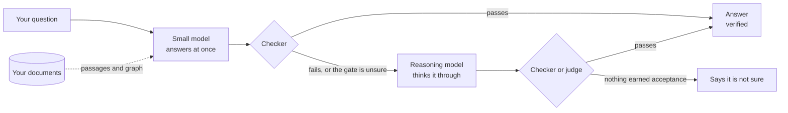

<div align="center">

# Nafs-Aql

### Fast when it can. Careful when it must.

**An AI assistant that runs on your own computer, answers from your own documents, and tells you how sure it is.**
No GPU. No API key. Nothing leaves your machine.

[](https://github.com/rismanmattotorang/nafsaql/actions/workflows/ci.yml)
[](LICENSE)
[](docs/features_and_results.md)
[](https://dirac.id)

[Quick start](#quick-start) ·
[Your documents](#ask-your-own-documents) ·
[How it works](#how-it-works) ·
[Numbers](#the-numbers) ·
[Docs](docs/index.md) ·
[Technical report](docs/report/nafs_aql_report.pdf)

<br>


</div>

---

## What you get

- **Answers you can trust, or an honest "I'm not sure".** A small model answers straight away. A reasoning model steps in only when a question is hard enough to be worth the wait. When a problem has a checkable answer (maths, code that must pass tests, data that must match a schema), a checker, not the model, decides if it is right.
- **Your documents, searchable and quotable.** Drop in PDFs, Word files, slides, LaTeX, web pages or notes. Ask questions in plain language and get answers with numbered sources, and a map of who and what your documents talk about.
- **Runs on an ordinary laptop or desktop.** Built and tested on a 4-core Intel CPU with no graphics card. Your data stays on your machine.
- **Shows its work.** Every answer says whether it was *verified*, a *consensus*, or *unverified*, how long each step took, and what the gate decided.
- **Built for teams.** Shared chat rooms, a research lab for comparing settings, drift alerts, an audit trail, and a documented API.

## Ask your own documents

Upload files, and Nafs-Aql reads them into a private knowledge base on your machine. Ask a question and it finds the passages that answer it, writes the answer, and cites them.

<table>
<tr>
<td width="50%"><br><sub><b>Your library.</b> PDF, Word, PowerPoint, LaTeX, web pages, Markdown and text. Search by words, by meaning, or both.</sub></td>
<td width="50%"><br><sub><b>Answers with sources.</b> Every claim points at the passage that states it.</sub></td>
</tr>
<tr>
<td colspan="2"><br><sub><b>A map of your documents.</b> The things they name and how they relate, each relation carrying the sentence that states it, checked against the passage word for word.</sub></td>
</tr>
</table>

What is under it, in plain terms:

| | |
|---|---|
| **Finds the right passage** | Searches by exact words and by meaning together, and indexes each passage with its title, heading and a one-line summary so a passage that says "it" is still found by what it is about. |
| **Reads, not just retrieves** | The answer is built from the sentences that matter, whole, rather than from the first characters of each passage. |
| **A graph you can check** | Entities and relations are read from your documents under a type list you can edit. A relation is kept only if the sentence behind it really appears in the passage. |
| **Follows connections** | Questions that need two steps ("what did the engine that merged in Phase 19 expose?") walk the graph two hops and show the chain. |
| **Says which searches ran** | Each answer lists the searches it used and why any were skipped. |

## Quick start

You need Rust 1.96+, Python 3.10+, and about 4 GB of disk for the models.

```bash
git clone https://github.com/rismanmattotorang/nafsaql.git && cd nafsaql
make models      # downloads the two models (about 3.6 GB)
make up          # builds everything, starts the models and the app
```

Open **http://127.0.0.1:8080**. Try the *Verified math* example, then press **Think harder** on the answer. `make down` stops everything.

To use your documents, open **Knowledge**, create a library, drag files in, then pick it from the chat box. The full set-up notes, including other serving options, are in [docs/serving_and_operations.md](docs/serving_and_operations.md).

## How it works



The gate escalates only when the expected error saved is worth the extra waiting time, and once it has learned from enough checked answers it keeps a quick answer only in a confidence band whose error rate is certified, not averaged. Where a checker exists its verdict is final; agreement between samples is a hint, never proof. A question asked twice is treated as a sign the first answer missed. Everything else is labelled honestly, and the system can decline to answer.

## The numbers

Measured on one 4-core Intel i3-8100 with no GPU, shared with other work, so absolute speeds are lower bounds. Every figure comes from a stored run in [`benchmarks/`](benchmarks/).

| | |
|---|---|
| Hard questions: same accuracy at **36 %** of the cost of always thinking | gate with a visible checker, 6 mixed tasks |
| Reasoning that stops when the checker is satisfied | **−52 %** reasoning tokens, **−44 %** time |
| The built-in engine against llama.cpp | **131 s vs 303 s** for twelve checked prompts, same accuracy |
| Several people at once | **14 → 25 tokens/s** from 1 to 4 users, each answer identical to what they would get alone |
| Passage retrieval with the right context | closed-book answers **2 of 20** held-out questions; with passages, **18 of 20** |
| Security and quality | **436** Rust tests, **26/26** security probes, **67/67** end-to-end checks |

We also publish what did not work: speculative decoding, 1-bit weights, concurrent hedging and more. See [features and measured results](docs/features_and_results.md).

## Status

A research preview, built in the open. It runs end to end on a CPU today. The release-scale evaluation (thousands of paired items) and the first model-distillation cycle need a faster machine and are not done yet; the current gate status is in [docs/roadmap/STATUS.md](docs/roadmap/STATUS.md).

## Documentation

| | |
|---|---|
| [User guide](docs/user_guide.md) | using the app, rooms, the lab, your documents |
| [Technical report](docs/report/nafs_aql_report.pdf) | the model, the proofs, the implementation and every measurement |
| [Features and measured results](docs/features_and_results.md) | everything built, phase by phase, with evidence |
| [Serving and operations](docs/serving_and_operations.md) · [Runbook](docs/operations/operator_runbook.md) | other serving profiles, configuration, security, deployment |
| [API reference](docs/api/api_reference.md) | the documented endpoints (OpenAPI 3.1) |
| [Specification](docs/spec/nafs_aql_spec.pdf) · [Knowledge specification](docs/spec/knowledge_base_spec.md) | requirements and interfaces |
| [All documents](docs/index.md) | research notes, decisions, assumptions |

## Contributing

Issues and pull requests are welcome. Run `make test`, keep `cargo fmt` and `cargo clippy -D warnings` clean, back every performance claim with an interleaved comparison (the scripts in `scripts/` show how), and record a judgement call in `ASSUMPTIONS.md` rather than burying it in code.

## Cite

```bibtex
@techreport{nafsaql2026,
  title       = {Nafs-Aql: A Verifier-Gated Dual-Process Architecture on Small Qwen Models for CPU-Only Deployment},
  author      = {{Dirac R\&D Team}},
  institution = {Dirac},
  year        = {2026},
  url         = {https://github.com/rismanmattotorang/nafsaql}
}
```

## License

[Apache License 2.0](LICENSE). Qwen3 model weights, llama.cpp, vLLM and the evaluation datasets keep their own licences; see [NOTICE](NOTICE).

---

<div align="center">

**Nafs-Aql is built by the Dirac R&D Team.**
[Dirac](https://dirac.id) is an Indonesian deep-tech startup focused on quantum computing.

</div>
