<div align="center">

# Nafs-Aql

### Fast when it can. Careful when it must.

**An AI assistant that runs on four CPU cores, answers from your own documents, and tells you when it is not sure.**

Built by the [Dirac](https://dirac.id) R&D Team.

[](https://github.com/rismanmattotorang/nafsaql/actions/workflows/ci.yml)
[](LICENSE)
[](docs/features_and_results.md)
[](rust/)
[](docs/release/RELEASE-0.2.0.md)

[**Website**](https://rismanmattotorang.github.io/nafsaql/) · [Quick start](#quick-start) · [The product](#the-product) · [Proof](#proof) · [How it works](#how-it-works) · [Use cases](#who-it-is-for) · [Paper](docs/report/nafs_aql_report.pdf) · [Docs](docs/index.md)

<br>

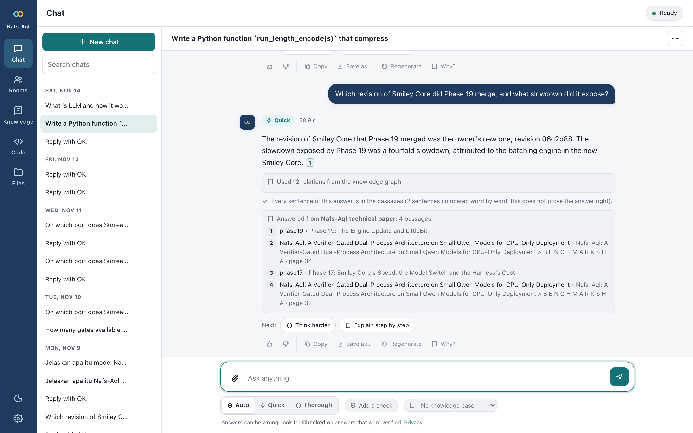

</div>

---

## The problem

Small models are fast and wrong too often. Large models are careful and need a GPU or someone else's servers.
Neither tells you which of its answers to trust.

## The product

**01 — Checked, or "Not sure".** A small model answers at once. A reasoning model steps in only when the question is worth the wait. Where an answer can be checked (maths, code against tests, data against a schema), a checker decides, not the model. Every answer is labelled *Checked*, *Cross-checked* or *Not checked*.

**02 — Your documents, with sources.** Drop in PDF, Word, PowerPoint, Excel, CSV, LaTeX, web pages or notes, into a library or beside one question. Ask in plain language. Every claim points at the passage that states it, the answer says which of its sentences are *not* in those passages, and a map shows what your documents talk about.

**03 — It remembers, and shows what it remembers.** Tell it something in one chat and ask in another. What you say about yourself ("call me …", "I prefer …", "my manager is …", "remember that …") becomes a memory file you can read, edit and delete, every change is logged and can be undone, and your preferences apply to every answer. Private chats and rooms are never remembered.

**04 — Everything in one place.** Documents, memories, skills and saved chats live in one tree with an address for each (`nafs://…`). Every folder and document has a one-line summary and an overview made without a model, a search can stay inside one folder, and a library can be compiled into a wiki, a map of its terms or a report.

**05 — Both models are ready when you ask.** While you read an answer, the models read the conversation, so the next answer starts sooner: 0.7 s instead of 4.3 s to the first word of a quick answer, 2.4 s instead of 18.6 s for a reasoned one, and about 2 s instead of 37 s when the careful model takes over a chat the quick one was answering. Sending a message stops the reading at once; Settings → Speed turns it off.

**06 — Answers you can use.** Tables sort and export, code has line numbers and a save button, charts, diagrams and formulas save as pictures, and an answer or a whole chat is saved as Word, PDF, PowerPoint, Excel, CSV, LaTeX, a web page, Markdown or plain text, made on your machine. Ask again in place, or edit an earlier question and send it again.

**07 — Code that passed its tests.** Describe a small Python function and the tests it must pass. It is written, run in a sandbox with no network, and shown step by step; the run ends when the tests pass, and you can stop it.

**08 — Four CPU cores.** No GPU. No API key. Nothing leaves your machine.

## Proof

Measured on one shared 4-core Intel i3-8100. Every figure comes from a stored run in [`benchmarks/`](benchmarks/).

| | |
|---|---|
| **36 %** | of the cost of always reasoning, at the same accuracy on hard questions |
| **0.15 s** | to search 847 passages by words and meaning together; the search itself takes 0.2 ms, the rest is reading the question |
| **18 of 20** | held-out questions answered with passages, against 2 of 20 without |
| **38 of 44** | answers made up without reading are flagged by the check against the passages; it flags 1 of 42 right ones, and it cannot catch a wrong number taken from the right passage |
| **+23 %** | faster reading of a prompt, by reading with all four cores and writing with three; an answer from documents arrives 16 % sooner |
| **10×** | as often does a follow-up question ("and how fast is it?") find its passage first, when it is read with the question before it |
| **14 of 14** | live checks of the memory pass: a fact is found from another chat by its words or its meaning, and is gone when you forget it |
| **0.7 s** | to the first word of a later turn in a quick conversation, where it was 4.3 s; 2.4 s where it was 18.6 s when the reasoning model answers (median of 9 and of 6 turns) |
| **12 of 12** | small Python functions pass their tests on the code agent's first step, where 1 of 12 did before a change to its instructions (median 7.9 s a step) |

The rest, including what did not work, is in [features and measured results](docs/features_and_results.md).

## Quick start

You need Rust 1.96+, Python 3.10+ and about 4 GB of disk.

```bash
git clone https://github.com/rismanmattotorang/nafsaql.git && cd nafsaql
```

```bash
make models
```

```bash
make up
```

Open **http://127.0.0.1:8080**. `make down` stops everything. Other ways to serve it: [serving and operations](docs/serving_and_operations.md).

## How it works

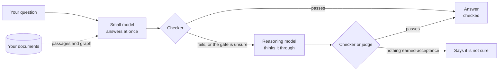

The gate escalates only when the error it expects to save is worth the waiting time. Where a checker exists its verdict is final; agreement between samples is a hint, never proof.

## New in 0.2.0

- **A faster engine, from five ideas.** The reasoning of FreeToken (arXiv 2608.16157) applied to a dense model on a CPU: a continued conversation takes its kept state without a copy (457 ms saved at 2,048 tokens on the reasoning model), the first word comes with the last piece of the prompt (1,075 ms to 568 ms), idle threads take work nobody has started (19 to 33 % faster on four threads), the model file is read while the first request is (14.6 s to 9.2 s), and both models read the conversation between turns. [Assessment and results](docs/research/freetoken_assessment.md).
- **Documents in and out.** Excel and CSV join the readers; a file can be attached to one question; answers and chats are saved in nine formats.
- **A product pass over every form.** Settings in plain language with presets and a search box; labels, hints and errors on every control; a configuration file that names a misspelt key at start instead of ignoring it.
- **A Code page**, and an agent whose first step now writes the program. [What changed and why](docs/decisions/027-product-quality-phase35.md) · [Release notes](docs/release/RELEASE-0.2.0.md).

## Who it is for

People whose documents cannot leave the building, and who need to know which answers were checked: a law firm's matter file, a hospital's policies, an audit team's control library, a school's maths and programming practice, a plant with no outside network, a newsroom's source documents. The [website](https://rismanmattotorang.github.io/nafsaql/use-cases.html) sets out sixteen such cases, each with the evidence for the need and the limit to know first. No deployment is claimed for any of them.

## Ask your documents

<table>
<tr>
<td width="50%">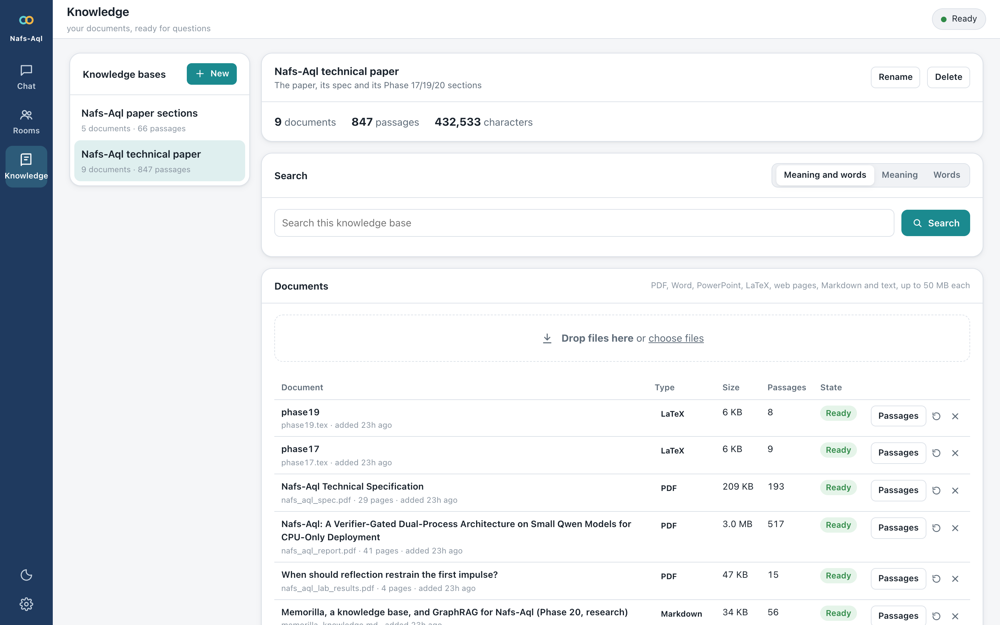<br><sub><b>Your library.</b> Searchable by its words seconds after upload, by meaning soon after.</sub></td>
<td width="50%">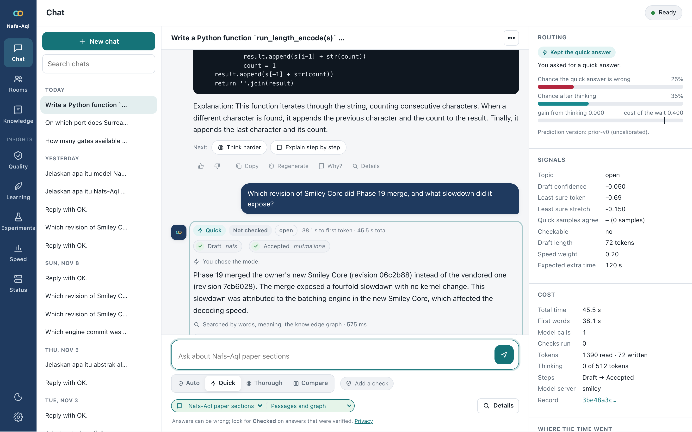<br><sub><b>Answers with sources.</b> Click a number to read the passage.</sub></td>
</tr>
<tr>
<td width="50%">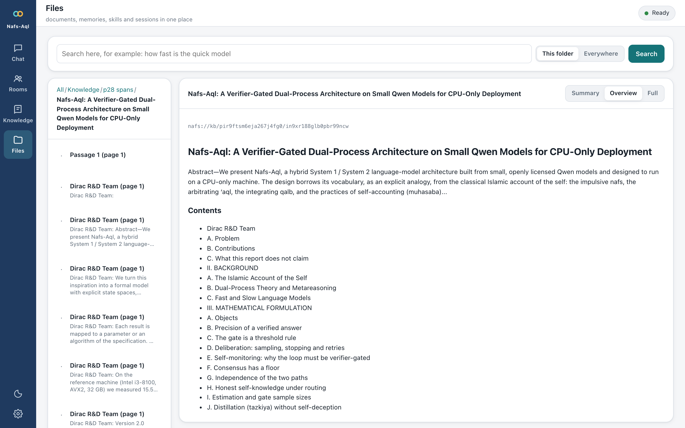<br><sub><b>One place for everything.</b> A document opens at its overview: sections, tables, key terms.</sub></td>
<td width="50%">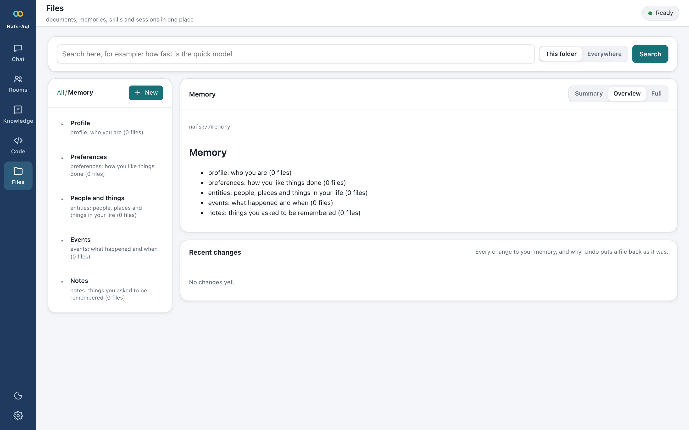<br><sub><b>Memory you can edit.</b> Every change is listed with its reason, and can be undone.</sub></td>
</tr>
<tr>
<td width="50%">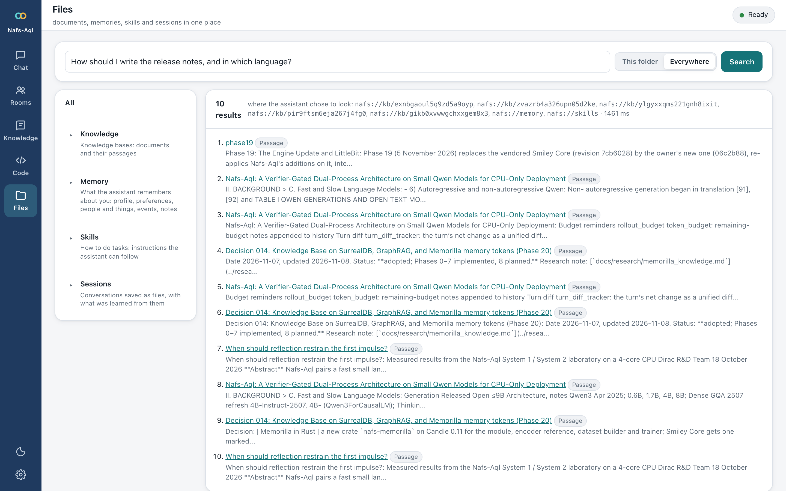<br><sub><b>Search everything, or one folder.</b> Documents, memories and skills in one result list.</sub></td>
<td width="50%">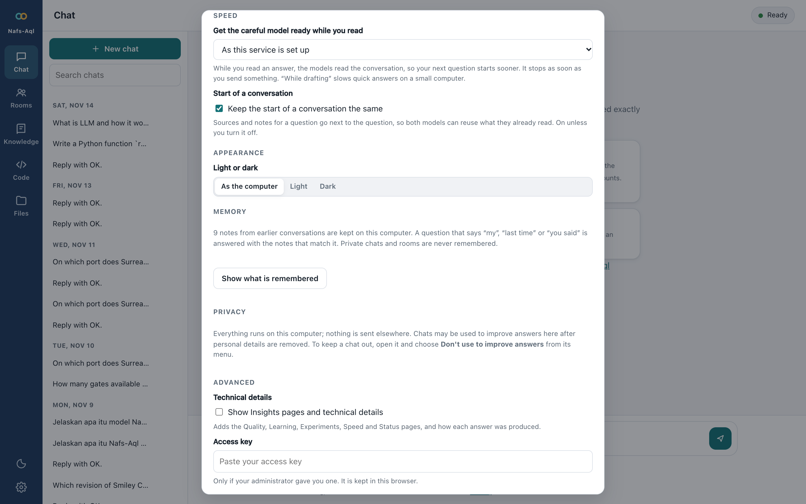<br><sub><b>Ready when you need it.</b> The careful model reads the conversation while you read the answer.</sub></td>
</tr>
<tr>
<td width="50%">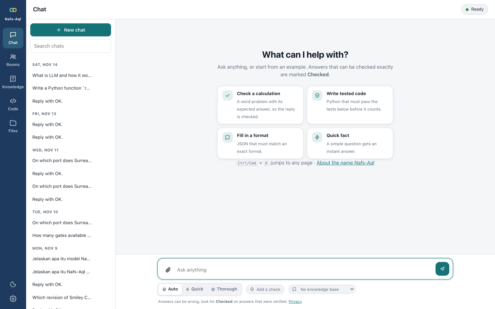<br><sub><b>A clear start.</b> One question, four examples, and a hint that Ctrl/Cmd+K jumps anywhere.</sub></td>
<td width="50%">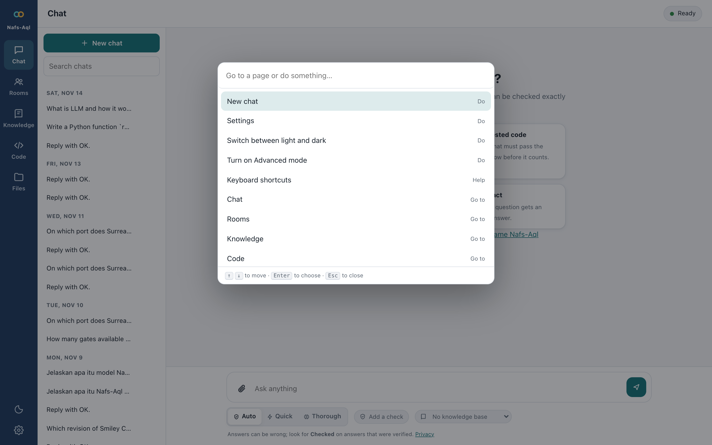<br><sub><b>Jump anywhere.</b> Ctrl/Cmd+K lists pages and actions; type to narrow, Enter to choose.</sub></td>
</tr>
<tr>
<td width="50%">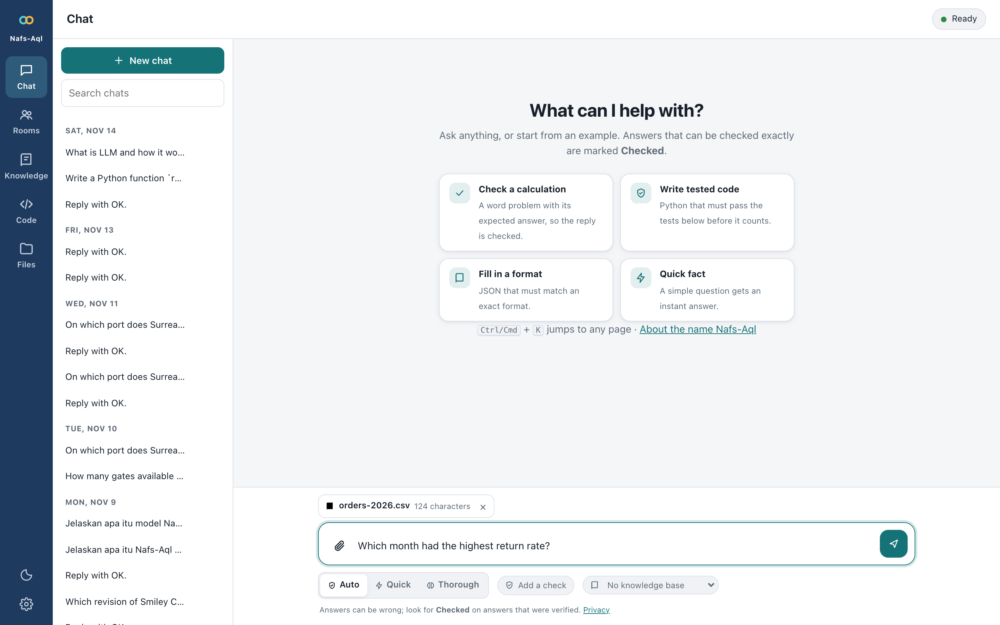<br><sub><b>A file beside one question.</b> PDF, Word, PowerPoint, Excel, CSV and more are read on your machine; the chip says how much of the file fits.</sub></td>
<td width="50%">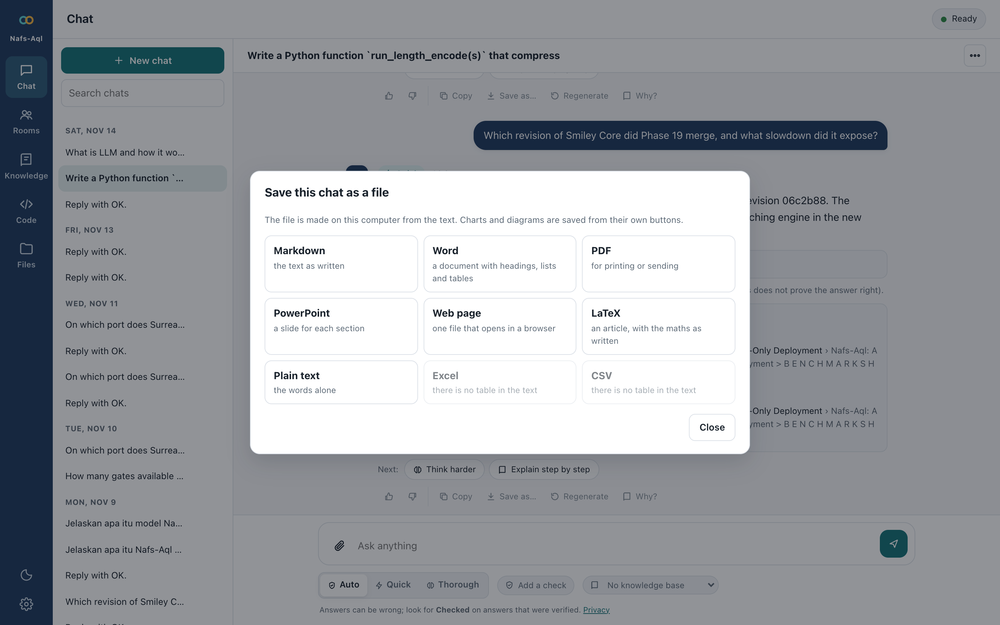<br><sub><b>Take the answer with you.</b> Nine formats, written on your machine; the table formats appear when the text has a table.</sub></td>
</tr>
<tr>
<td width="50%">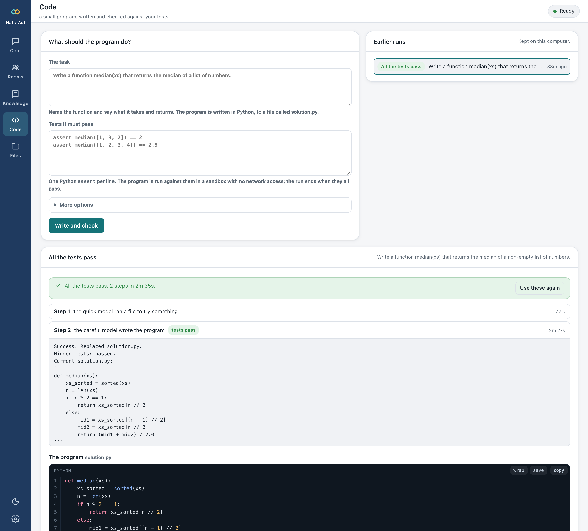<br><sub><b>Code that passed its tests.</b> Each step shows which model took it and what the tests said.</sub></td>
<td width="50%">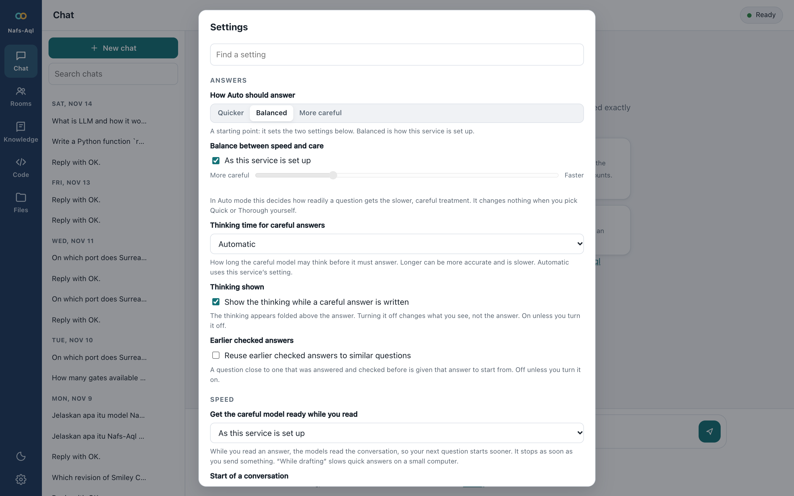<br><sub><b>Settings you can read.</b> Three presets, a hint under every row, a search box, and one button to put everything back.</sub></td>
</tr>
<tr>
<td colspan="2">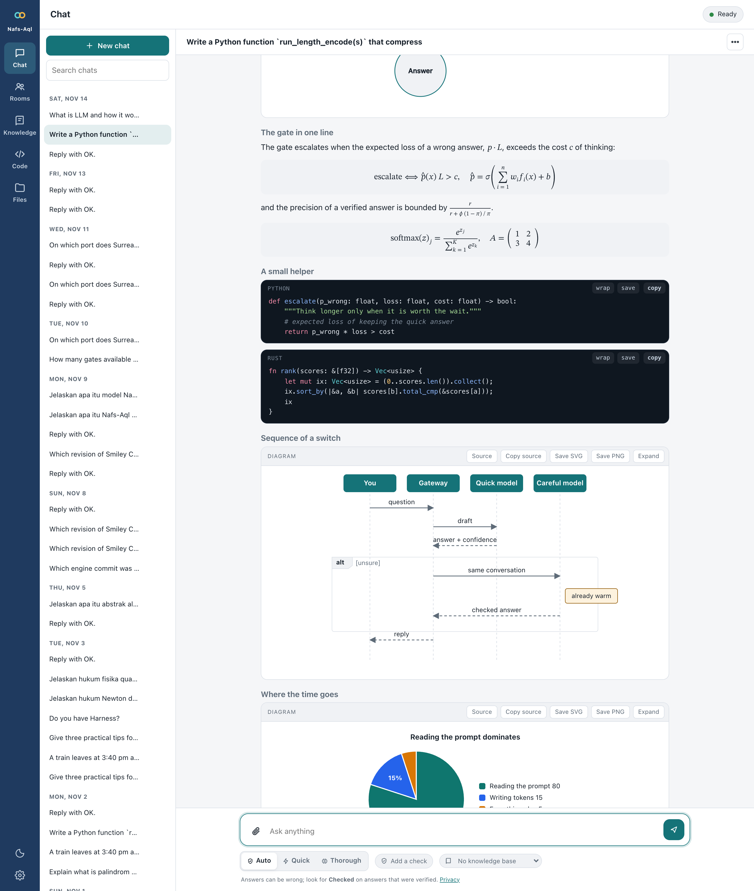<br><sub><b>Answers drawn as you read them.</b> Tables, formulas, diagrams and code are rendered, with copy buttons; unfinished ones stay plain text until they close. The same sample in the <a href="docs/shared/screenshots/rich_answer_dark.png">dark theme</a>. A real streamed answer, a phone-width page and both themes were checked.</sub></td>
</tr>
<tr>
<td colspan="2">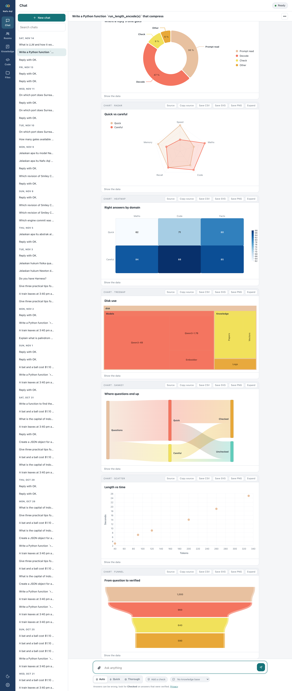<br><sub><b>Charts that look like charts.</b> Ask for a bar, line, pie, donut, radar, scatter, heat map, treemap, funnel or sankey chart and the answer is drawn with <a href="https://nivo.rocks">Nivo</a>; save it as PNG, SVG or CSV, or expand it. The <a href="docs/shared/screenshots/charts_dark.png">dark theme</a> follows the page. Diagrams (flowchart, sequence, state, pie) and formulas have the same save buttons.</sub></td>
</tr>
<tr>
<td colspan="2">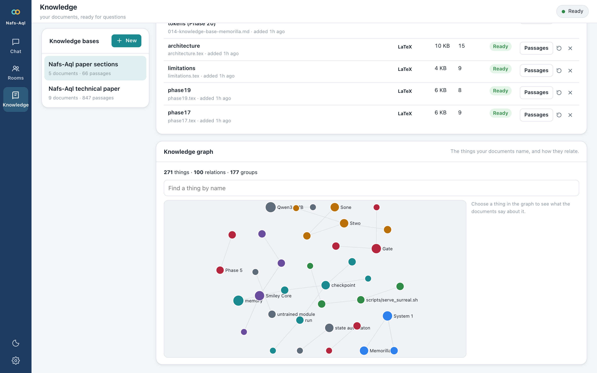<br><sub><b>A map of your documents.</b> Drawn from the text the moment a file is read; a deeper pass adds relations, each with the sentence that states it.</sub></td>
</tr>
</table>

PDFs are read by their layout, not line by line: two-column papers come out in reading order, section titles become headings that every passage carries, tables stay as rows, and running headers and page numbers are dropped, with no model and no extra download (166 of 173 section titles found, against 11 before; 15 ms a page). Each passage is also searched by its sentences, so a question about one fact finds the passage that states it (answer first for 88 % of quoted questions, against 77 % before). Search runs in memory, beside the store that keeps your files, so it does not slow down when the machine is busy. A typing slip in a question is matched to the nearest word your documents contain, and a follow-up such as "and how fast is it?" is searched together with the question before it. Reading a file again only re-reads what changed. Uploads are capped and checked, and deleting a library removes what was derived from it. Details: [Knowledge specification](docs/spec/knowledge_base_spec.md), its [search update](docs/spec/knowledge_sota_spec.md), [how it compares with vLLM Semantic Router and Memorilla](docs/research/router_memory_gaps.md), [what was taken from LiteParse and semtools](docs/research/liteparse_semtools_gaps.md), and [the context filesystem, after OpenViking](docs/spec/context_fs_spec.md).

## Status

A research preview, built in the open, running end to end on a CPU today. Current release: **0.2.0** ([notes](docs/release/RELEASE-0.2.0.md)); before it, [0.1.0](docs/release/RELEASE-0.1.0.md).

- **Open:** questions worded differently from the document are found in the first eight passages only a quarter of the time. The remedies need larger models than this release ships.
- **Not done:** the release-scale evaluation, the first distillation cycle and the pre-training of the memory-token module need a faster machine. The learned gate waits for its ledger: 1,294 of the 2,900 checked answers it asks for.
- **Did not work, and published:** speculative decoding, 1-bit weights, concurrent hedging, a larger embedding model, score-based fusion, a graph arm in everyday search, guessing a question's difficulty before answering it, cache-blocking the engine's prompt reading, a summaries-first knowledge prompt (it lost answers at the same size), guessing which document a question is about, warming the careful model while the quick one drafts (every quick answer 75 % slower). A shorter knowledge prompt is 20 to 26 % faster and is left off: it cost 3 right answers in 50.

Current state: [docs/roadmap/STATUS.md](docs/roadmap/STATUS.md).

## Documentation

| | |
|---|---|
| [Website](https://rismanmattotorang.github.io/nafsaql/) | the product, how it works, sixteen use cases, the evidence |
| [User guide](docs/user_guide.md) | the app, rooms, the lab, your documents |
| [Paper](docs/report/nafs_aql_report.pdf) | the formal model and its proofs, the architecture, every measurement |
| [Features and measured results](docs/features_and_results.md) | everything built, with evidence, and how it compares |
| [Answer rendering](docs/decisions/024-rich-answers-and-graph-phase31.md) | tables, maths, diagrams and code, and the knowledge graph |
| [Engine: FreeToken's ideas on a CPU](docs/research/freetoken_assessment.md) · [Product pass](docs/decisions/027-product-quality-phase35.md) | what 0.2.0 changed, with its measurements |
| [Context filesystem](docs/spec/context_fs_spec.md) · [ShadowPrefill](docs/spec/shadow_prefill_spec.md) | one place for documents, memory, skills and chats; keeping the careful model warm |
| [Serving](docs/serving_and_operations.md) · [Runbook](docs/operations/operator_runbook.md) · [API](docs/api/api_reference.md) | running it |
| [All documents](docs/index.md) | specifications, research notes, decisions |

## Contributing

Issues and pull requests are welcome. Run `make test`, keep `cargo fmt` and `cargo clippy -D warnings` clean, back a performance claim with an interleaved comparison, and record a judgement call in `ASSUMPTIONS.md`.

## Cite

```bibtex
@techreport{nafsaql2026,
  title       = {Nafs-Aql: A Verifier-Gated Dual-Process Architecture on Small Qwen Models for CPU-Only Deployment},
  author      = {{Dirac R\&D Team}},
  institution = {Dirac},
  year        = {2026},
  url         = {https://github.com/rismanmattotorang/nafsaql}
}
```

## License

[Apache License 2.0](LICENSE). Qwen3 model weights, llama.cpp, vLLM and the evaluation datasets keep their own licences; see [NOTICE](NOTICE).

---

<div align="center">

**About Dirac.** [Dirac](https://dirac.id) is an Indonesian deep-tech startup focused on quantum computing.

</div>
