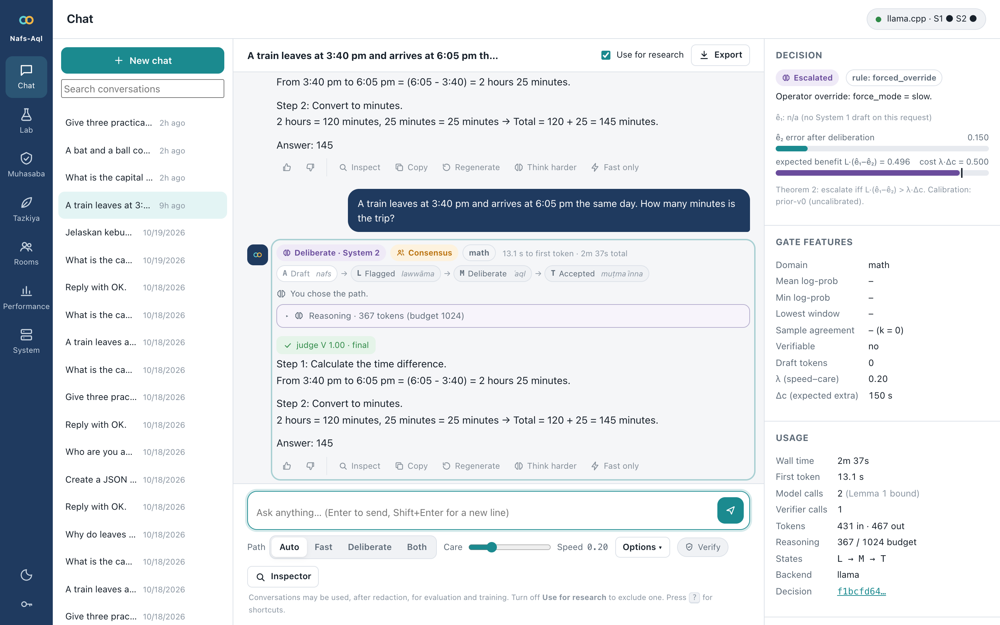
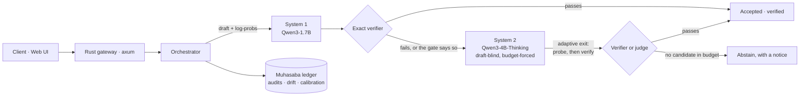
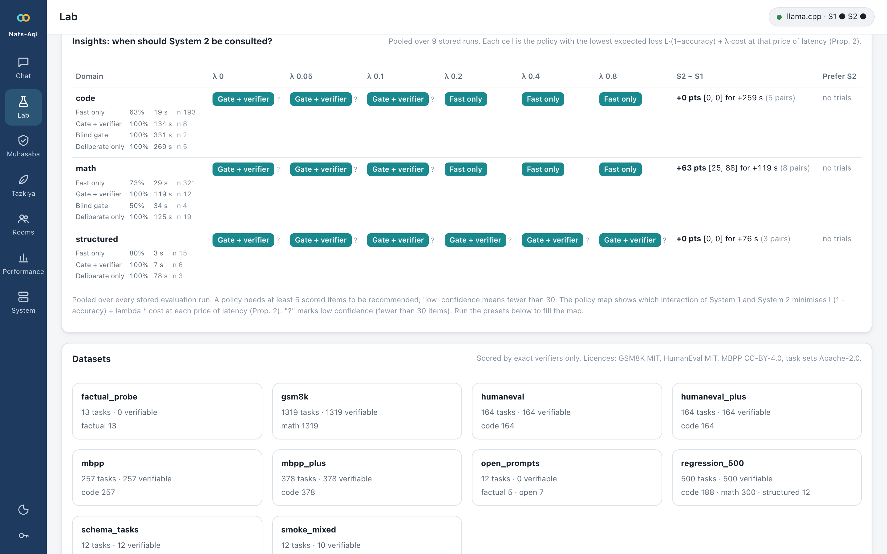
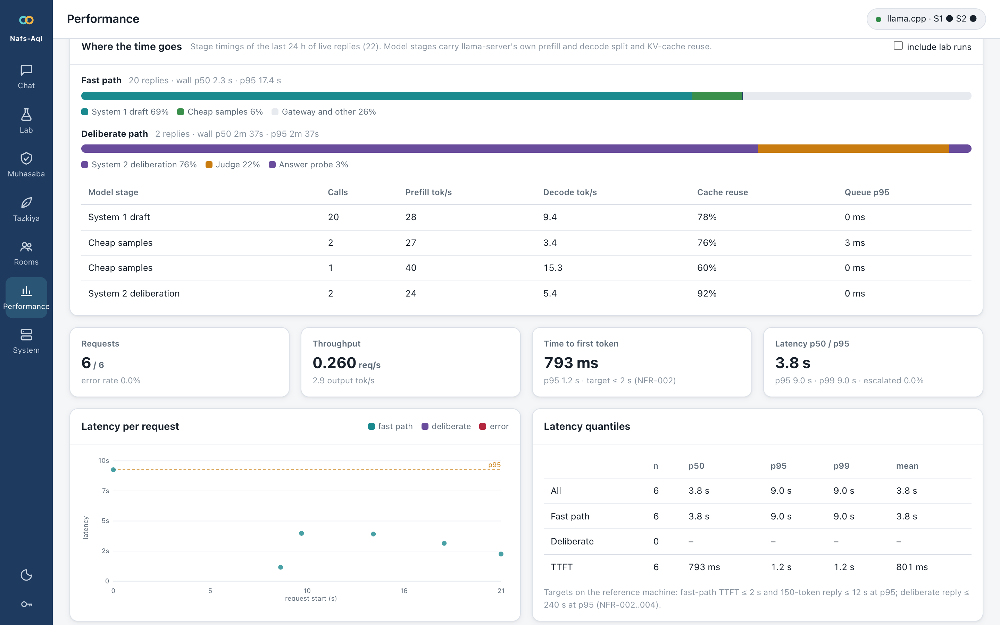
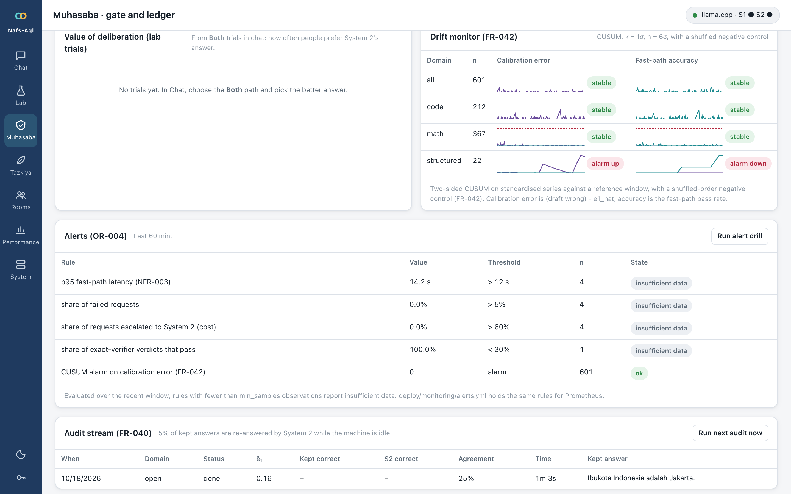
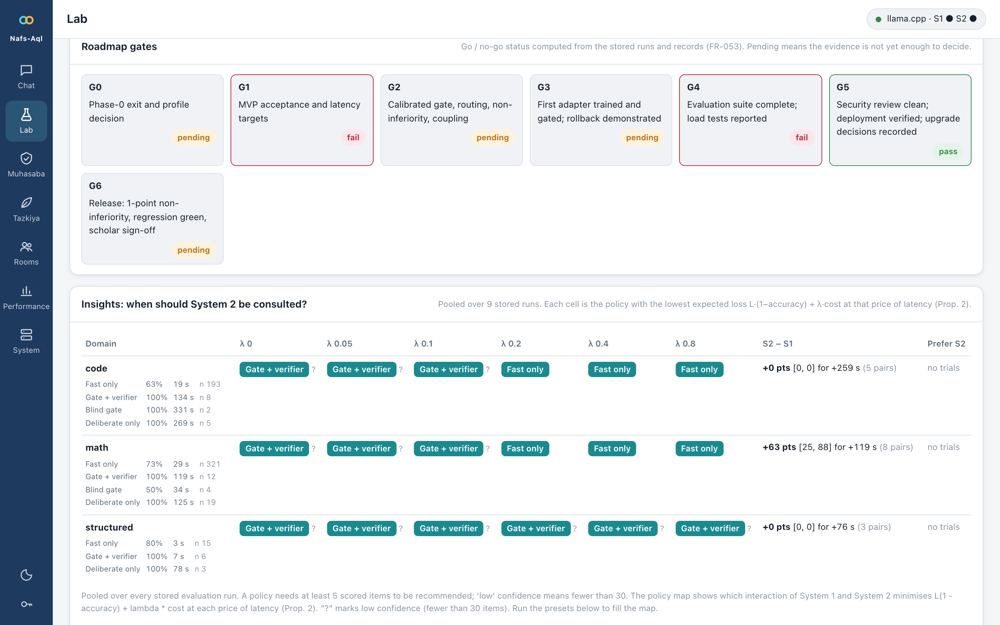
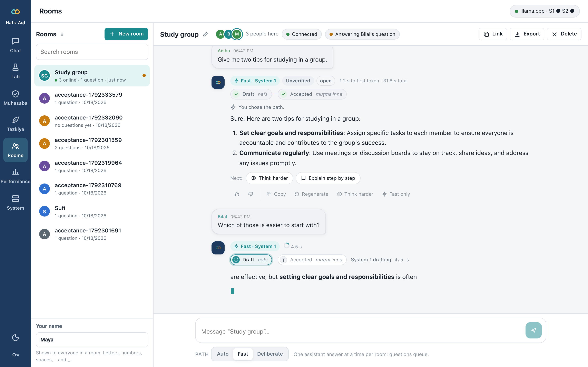
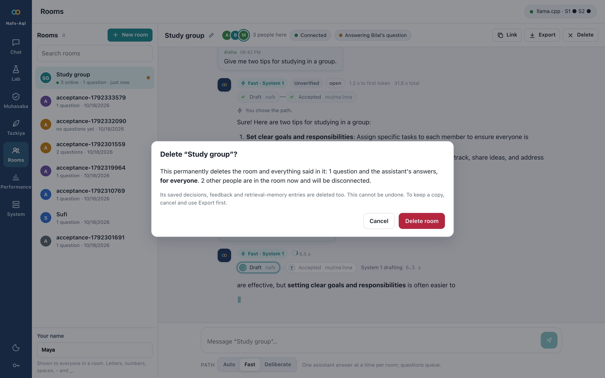

<div align="center">

# Nafs-Aql

### Fast when it can. Careful when it must.

**A verifier-gated dual-process AI that runs on a CPU.**
A small model answers at once. A reasoning model deliberates only when it pays. Exact checkers, not model agreement, decide what counts as correct.

[](https://github.com/rismanmattotorang/nafsaql/actions/workflows/ci.yml)
[](LICENSE)
[](rust/Cargo.toml)
[](#measured-results)
[](docs/roadmap/STATUS.md)
[](https://dirac.id)

[Technical report](docs/report/nafs_aql_report.pdf) ·
[Slides](docs/slides/nafs_aql_slides.pdf) ·
[Specification](docs/spec/nafs_aql_spec.pdf) ·
[Roadmap](docs/roadmap/nafs_aql_roadmap.pdf) ·
[Status](docs/roadmap/STATUS.md) ·
[User guide](docs/user_guide.md)

<br>



</div>

---

## Why Nafs-Aql

Reasoning models get hard questions right by spending inference compute, and waste it on easy ones. On a laptop-class CPU the waste is not abstract: Qwen3-4B-Thinking decodes at roughly 6–8 tokens/s on four cores, so one long chain of thought is minutes. Nafs-Aql asks a single question and answers it with measurements:

> **When is deliberation worth its cost, and who decides that it worked?**

Three design rules follow.

| Rule | What it means in the code |
|---|---|
| **Cheap first** | System 1 (Qwen3-1.7B) drafts immediately. The *Aql Gate* escalates to System 2 (Qwen3-4B-Thinking-2507) only when the expected error saved outweighs the price of the extra latency: `L·(ê₁ − ê₂) > λ·Δc`. |
| **Evidence, not agreement** | Where an exact checker exists (math references, Python unit tests in a sandbox, JSON Schema) its verdict is final. Agreement between samples is a *flag*, never proof. Everything else is labelled *consensus* or *unverified*, and the system can *abstain*. |
| **Measure, then keep** | Every speed-up has to survive an interleaved A/B on the reference machine. The rejected ones are published next to the adopted ones. |

## How it works



Every request moves through a small, bounded automaton and the reply says where it ended up:

| State | Meaning | Design vocabulary |
|:--:|---|---|
| **A** | System 1 drafts (fast, no reasoning) | *nafs*: the first impulse |
| **L** | The gate or a verifier flags the draft | *lawwāma*: self-reproach |
| **M** | System 2 deliberates, never seeing the draft, within a token budget | *ʿaql*: reflection |
| **T** | Accepted with an assurance level: *verified*, *consensus* or *unverified* | *muṭmaʾinna*: at rest |
| **X** | Abstain: no candidate earned acceptance | *tawaqquf*: withholding judgement |

> The Islamic vocabulary of the self is a **design analogy**, not a theological claim. Engineering names are primary in code and documents; the analogy text is awaiting scholar review (gate G6, SR-005).

## What is inside

| | |
|---|---|
| 🧠 **Aql Gate** | A threshold rule derived from a decision-theoretic model, with a fixed-rule mode, a held-out *calibrated* mode (promoted only if ECE ≤ 0.05) and a *budget* mode with a target escalation rate. Early escalation stops a doomed draft after 32 tokens. |
| ✅ **Verifier Hub** | Numeric and SymPy math, code tests in an OS sandbox (macOS `sandbox-exec`, Linux namespaces plus seccomp), JSON Schema. True- and false-accept rates are *measured* with a mutation harness and shown on every verdict. |
| ⏱ **Adaptive reasoning exit** | System 2's reasoning is probed for its answer at reflection points; on verifiable tasks the exact checker decides whether to stop. The final answer is still generated after the reasoning, as on the standard path. |
| 🔬 **Research lab in the browser** | Paired experiments with bootstrap CIs, exact McNemar tests and Bonferroni correction; a pooled *policy map* of the best System 1 / System 2 policy per domain and price of latency; human *Both* trials; resumable runs. |
| 📈 **Latency attribution** | Every reply records where its time went: queue, prefill, decode and KV-cache reuse per model stage, straight from llama-server's timings. |
| 🛡 **Operations built in** | Drift monitor (CUSUM with a shuffled negative control), alerts with a drill mode, Prometheus metrics, audit stream, retention purge, secure-by-default bind, token auth, TLS recipes. |
| 🔁 **Distillation loop (Tazkiya)** | Verified System 2 traces become System 1 training data under a promotion gate with one-command rollback. The GPU training run itself is deferred. |
| 👥 **Rooms** | Shared chats over WebSocket: everyone sees each question and the assistant's answer as it is written. Create, rename, search, share a link, export, and delete for good (the room, its messages and every ledger row made from it, in one transaction). Presence, typing, a queue of assistant turns, unique display names, automatic reconnection, and a join snapshot that delivers every turn exactly once however late you arrive. |
| 🧭 **Sequential evidence (Phase 8)** | The rules that read a *stream* of evidence come from sequential analysis and decision neuroscience: a lowest-window confidence signal whose early crossing *is* the full-draft decision (a running minimum), a posterior stopping rule with a collapsing bound for the adaptive exit, Wald's bound on what an early escalation can promise, and the optimal probe interval. A review of quantum theories of consciousness is included as a negative result, with the test each idea failed. |
| 🧮 **Math and code harness (Phase 10)** | Mechanisms taken from two open agent harnesses, as pure Rust in `nafs-harness`. From [Open Math Harness](https://github.com/openmathmodel/open-math-harness): **Lean 4 as an exact verifier** under its frozen-statement protocol (no `sorry`, no axioms, the elaborated type must match), and **best-first repair** over a tree of candidates scored by the verifier, with per-assert credit on code. From [OpenAI Codex](https://github.com/openai/codex): **`apply_patch` repairs** with its fuzzy matcher, head-and-tail evidence, and a **code agent** (`POST /v1/harness/code`) that patches and runs its workspace in the sandbox and stops only when the hidden tests pass. |
| 🤖 **Codex-style agent harness (Phase 11)** | The code agent's loop rebuilt on the mechanisms of Codex's agent core, adapted to a 1.7B/4B model on four CPU cores: an **append-only transcript** so llama-server's prompt cache reuses every earlier exchange (a cold 1,969-token prompt prefilled in 64 s, the same prompt plus one exchange in 3 s), harness-written **compaction**, Codex's `apply_patch` grammar as a **per-step GBNF grammar** that keeps the reasoning span free and stops decoding at the end of the action, a **whole-file edit policy** for short files, budget reminders, the run's cap enforced inside a model call, and the run's net diff. |
| 🔌 **Two serving profiles** | llama.cpp on bare metal (the reference), and vLLM's CPU backend in Docker, behind one OpenAI-compatible gateway. |

<table>
<tr>
<td width="50%"><br><sub><b>Lab.</b> Which policy wins, per domain and price of latency.</sub></td>
<td width="50%"><br><sub><b>Performance.</b> Where every second goes, with prefill, decode and cache reuse.</sub></td>
</tr>
<tr>
<td width="50%"><br><sub><b>Muhasaba.</b> Drift per domain, alert rules over live traffic.</sub></td>
<td width="50%"><br><sub><b>Gates.</b> Go / no-go computed from stored runs, never typed in by hand.</sub></td>
</tr>
<tr>
<td width="50%"><br><sub><b>Rooms.</b> Presence, per-person bubbles, live answers, search and unread markers.</sub></td>
<td width="50%"><br><sub><b>Delete.</b> A room can be deleted for good; the dialog says what is lost.</sub></td>
</tr>
</table>

## Measured results

> **Read this first.** All numbers come from one Intel Core i3-8100 (4 cores, AVX2, 32 GB) that was *shared* with other workloads (load average 5–40), with tens of items per comparison. They show direction, not release-grade statistics; absolute speeds are lower bounds. Each figure is generated from stored runs (`benchmarks/`, `docs/publication/`), and the release gates need 700–6,200 paired items.

**What worked**

| Change | Effect | Evidence |
|---|---|---|
| Gate with the exact verifier visible, vs always deliberating | Same accuracy (6/6 each) at **36 % of the cost** | Lab run on 6 mixed tasks |
| Adaptive reasoning exit (System 2) | **−52 % reasoning tokens, −44 % mean time**, 11/11 correct in both arms | paired run, 12 GSM8K items |
| Cheap samples only when the draft is uncertain | Factual fast path **12.6 s → 4.3 s** median; first token 1.37 s → 0.14 s | `benchmarks/samples_ab_factual.json` |
| Skip samples when an exact verifier decides | Draft median **13.4 s → 7.9 s** | `benchmarks/reference-machine/samples_skip_ab_SHARED_MACHINE.txt` |
| Early escalation of unconfident drafts | 100 % agreement with full-draft decisions on 40 prompts; ~116 tokens saved per early escalation | `benchmarks/early_escalation_study.json` |
| Prompt-cache and verifier warm-up | First token 9.8 s → ~1 s; first verification 0.45 s → 3 ms | `docs/roadmap/STATUS.md` |
| Agreement samples on unverified math drafts (Phase 8) | wrong drafts flagged with AUROC **0.76** (token confidence 0.56–0.65); "any disagreement" catches **8 of 12** wrong drafts at 25 % escalation, expected accuracy **0.80 → 0.91–0.93** | `benchmarks/confidence_signal_study.json` (60 drafts with samples) |

**Verifier quality** (true-accept *r*, false-accept φ with 95 % upper bound)

| Verifier | Correct / mutants | r | φ (upper) |
|---|---|---|---|
| Math (numeric + SymPy) | 2,000 / 2,800 | 1.000 | 0.000 (≤ 0.001) |
| JSON Schema | 24 / 53 | 1.000 | 0.000 (≤ 0.067) |
| Code tests, EvalPlus | 364 / 754 | 0.995 | 0.109 (≤ 0.133)¹ |
| Rubric judge (System 2) | 23 / 22 | 1.000 | 0.045 (≤ 0.23) |

<sub>¹ An upper bound inflated by behaviourally equivalent mutants that also pass the far larger EvalPlus suites.</sub>

**What we tried and did *not* adopt** (kept in the repo, because a negative result is a result)

| Idea | Measured | Verdict |
|---|---|---|
| EAGLE-3 speculative heads (both models) | 1.04× / 0.99× decode at ~50 % acceptance; 8 draft tokens slower | verifying drafts costs real compute on 4 cores; opt-in only |
| Draft-model and n-gram speculative decoding | 6.5 vs 7.3 tok/s | not adopted |
| Flash attention, q8_0 KV cache, thread polling | no difference once runs were interleaved | a sequential run had shown a fake 30 % gain |
| Q4_0 / IQ4_NL repacked weights | 17–18 vs 18.8 tok/s | Q4_K_M stays |
| System 1 as the rubric judge | false-accept 0.27 vs 0.045 | a judge that accepts a quarter of wrong answers is not a verifier |
| Qwen3.5-2B as System 1 | **+17 points** accuracy (95 % CI +7 to +30, n = 30) but **3.7× slower** | adoption rule allows ≤ 1.3×; revisit on a faster host |
| Token-confidence escalation on unverified math (Phase 8) | best signal (lowest token) AUROC 0.65, lowest-window 0.58 on 150 drafts with exact labels; precision ≤ 0.47 against the 0.65 the gate's theorem needs at the default price | mechanism kept (exact, tested), threshold off; the study also showed the mean-log-prob rule escalates **0 of 31** wrong math drafts |
| Posterior exit rule for non-verifiable deliberation (Phase 8) | same answers on 6 factual prompts, **382 vs 357** reasoning tokens (more cautious when probes disagree first) | an option, not the default: `benchmarks/exit_rule_run.json` |
| A sequential test on the mean-log-prob early escalation | Wald's bound: ≥ 260 tokens to separate the threshold from its 0.04 margin at 5 % error; drafts are 47–291 tokens | kept as a measured heuristic, never made more aggressive |
| Quantum-consciousness mechanisms (Orch OR and descendants) | decoherence 10⁻¹³ s against 10⁻³ s dynamics; a CPU can follow at most ~30 two-level systems | nothing transfers as an algorithm; negative result, `docs/research/quantum_neuro_review.md` |

**Quality of the build** (final validation run, 29 October 2026, one quiet host; `benchmarks/harness_sweep.json`, `benchmarks/e2e_sweep.json`):

| Suite | Result |
|---|---|
| Rust unit and integration tests (nine crates, real Lean 4.35.0 included) | **190 / 190** |
| 9 Python tests, `clippy -D warnings`, `rustfmt` | clean |
| Security probes (`scripts/security_tests.py`; one real sandbox escape found and fixed earlier) | **26 / 26**, 0 open high findings |
| End-to-end sweep over every endpoint and UI page, incl. phone-width layout (`scripts/e2e_sweep.py`) | **65 / 65** |
| Rooms with simulated members (`scripts/rooms_test.py`) | **59 / 59** |
| Math and code harness sweep: real Lean, 6 attacks, code credit, validation, code agent (`scripts/harness_sweep.py`) | **40 / 40** |
| MVP acceptance A1–A9 (`scripts/mvp_acceptance.py`) | **9 / 9** (slow path 56 s against the 240 s target) |

The sweep found and fixed three defects in the Lean integration (an inconsistent 400 between `/v1/chat` and `/v1/verify`, Lean tasks classified as open questions with no retries, and a prompt that did not say Mathlib is absent). **One honest limit it exposed:** Qwen3-4B-Thinking (4-bit, CPU) cannot yet write valid Lean 4, even for `n + 0 = n`, so Lean tasks end in a labelled *abstain* unless a stronger prover is used. The Lean verifier itself is exact: it accepts real proofs and rejects a hidden `sorryAx`, a user axiom, `native_decide`, `#eval`, a changed statement and a shadowed `HAdd` instance.

## Quick start

**Requirements:** Rust 1.96+, Python 3.10+, and a CPU build of llama.cpp (tested with commit `797de63`).

```bash
git clone https://github.com/rismanmattotorang/nafsaql.git && cd nafsaql

# 1. llama.cpp, built CPU-only into third_party/ (about 5 minutes)
git clone https://github.com/ggml-org/llama.cpp third_party/llama.cpp
git -C third_party/llama.cpp checkout 797de63
cmake -S third_party/llama.cpp -B third_party/llama.cpp/build -DGGML_METAL=OFF -DLLAMA_CURL=OFF -DCMAKE_BUILD_TYPE=Release
cmake --build third_party/llama.cpp/build -j4 --target llama-server llama-bench

# 2. Models (Qwen3-1.7B and Qwen3-4B-Thinking-2507, GGUF Q4_K_M, about 3.6 GB)
make models

# 3. Build the Rust gateway, start both model servers and the gateway
make up
```

Open **http://127.0.0.1:8080**. Try the *Verified math* example, then press **Think harder** on the answer to watch System 2 deliberate. `make down` stops everything.

```bash
make test        # Rust tests: gate modes, calibration, judge, audits, cancellation, verifiers, sandbox
make contract    # live SSE events and stored records against the JSON Schemas
make acceptance  # MVP acceptance tests A1–A9 against the running stack
python3 scripts/e2e_sweep.py   # every endpoint and every UI page, in headless Chrome
python3 -I scripts/harness_sweep.py   # Lean, code credit, validation and the code agent (add --no-models for the fast part)
```

<details>
<summary><b>vLLM backend in Docker</b> (second serving profile)</summary>

```bash
scripts/serve_vllm_docker.sh start && scripts/serve_vllm_docker.sh wait   # vLLM CPU image on :8101
python3 scripts/vllm_check.py                                              # drives every request path through the gateway
```

Switch with *Use this backend* on the System page. The recipe was built and debugged against a vLLM 0.30 x86 CPU image (override with `VLLM_IMAGE`). Facts worth knowing: on an AVX2-only VM oneDNN has no BF16 kernels, so the model runs in FP32; vLLM's three processes cost about 3 GB beyond the weights, so Qwen3-1.7B needs an 11–12 GiB Docker VM. The gateway-side check was **not yet completed** on the reference host because it was too short of memory (see `docs/roadmap/STATUS.md`, P7-T10).

</details>

<details>
<summary><b>Configuration, security and deployment</b></summary>

- Config lives in `config/nafs-aql.toml`; `rust/target/release/nafs-gateway --check` validates it and the bind policy.
- The gateway refuses a non-loopback bind without tokens (`NAFS_AUTH_TOKENS` or `NAFS_AUTH_TOKENS_FILE`, 16+ characters each) unless `NAFS_ALLOW_INSECURE=1`. Browser requests must be same-origin.
- Code is verified in a network-denied sandbox with CPU, memory and wall-clock limits; `python3 -I scripts/security_tests.py` runs 26 live probes (sandbox escape, injection, auth, limits).
- **Platform notes.** macOS uses a `sandbox-exec` profile. Linux builds the same guarantees from namespaces and seccomp: new user, network, mount and PID namespaces; user data (`/home`, `/root`, `/tmp`, `/mnt`, `/media`, `/srv`, `/run/secrets` and others) replaced by empty mounts; every other mount read-only; no capabilities; a seccomp filter that denies `fork`, process spawning and mount-table changes; plus CPU, memory and wall-clock limits. The same escape tests run on both. What the Linux sandbox cannot hide is the gateway's own install, config and data directories (they stay readable, never writable), so keep those mode 0700 under a dedicated user (A-054). Linux needs unprivileged user namespaces (Ubuntu 24.04: `sudo sysctl -w kernel.apparmor_restrict_unprivileged_userns=0`), `unshare` and `setpriv` from util-linux, and a python3 with ctypes; in Docker it also needs `seccomp=unconfined` and `apparmor=unconfined`, which the compose file sets. `nafs-gateway --check` runs the whole stack and reports whether it works.
- Recipes for docker compose, systemd, launchd, Caddy and nginx TLS, Prometheus alerts and a Grafana dashboard are in `deploy/`; `scripts/verify_deploy.sh --live` checks them. The operator runbook is [docs/operations/operator_runbook.md](docs/operations/operator_runbook.md).

</details>

## Architecture

A Rust workspace of nine crates:

| Crate | Role |
|---|---|
| `nafs-gateway` | axum HTTP/SSE/WebSocket API (53 documented endpoints, OpenAPI 3.1), auth, metrics, background workers |
| `nafs-core` | orchestrator and automaton, Aql Gate, calibration, drift, backends (llama.cpp, vLLM) |
| `nafs-verify` | exact verifiers (numeric, SymPy, code tests, JSON Schema, Lean) and the sandbox, rubric judge support, mutation harness |
| `nafs-harness` | derived from Open Math Harness and Codex: Lean protocol, scoring and candidate tree, `apply_patch` and its grammar (GBNF), truncation, the append-only transcript and compaction, the code agent loop |
| `nafs-memory` | SQLite ledger, traces, retrieval memory (BM25), preferences |
| `nafs-eval` | datasets, paired statistics, policy map, resumable evaluation runs |
| `nafs-bench` | load-test protocol, latency breakdown |
| `nafs-web` | the embedded web UI (vanilla JS, no build step) |
| `nafs-types` | shared types and the error taxonomy |

The mathematics behind the gate (threshold rule, verifier-bounded precision, Beta-prior stopping, sizes of the release gates) is in the [technical report](docs/report/nafs_aql_report.pdf); the 100 requirements and 45 tasks are in the [specification](docs/spec/nafs_aql_spec.pdf) and [roadmap](docs/roadmap/nafs_aql_roadmap.pdf).

## Where the project stands

Phases 0–12 of the roadmap are implemented on the CPU reference machine; GPU training and scale-out are deliberately deferred. Gates are computed from stored evidence, and today they say:

| Gate | Status | Why |
|:--:|:--:|---|
| G1 MVP and latency | ❌ | acceptance 8/9: the deliberate path took 354 s against the 240 s target while the host was shared |
| G4 evaluation suite | ❌ | NFR-007: median 4-session p95 is 2.15× the single-session value (target ≤ 2×) |
| G5 security and deployment | ✅ | 26/26 security probes, 0 open high findings, deployment checks pass |
| G0, G2, G3, G6 | ⏳ | need release-scale runs (thousands of items), the first GPU training cycle, and the scholar review |

**Next:** evidence at scale on a faster host, the first Tazkiya (distillation) cycle, adaptive early exit across more domains, a learned router built from the policy map and human preferences, and the scholar review. The details, with estimates, are in the [roadmap](docs/roadmap/nafs_aql_roadmap.pdf).

## Documentation

| | |
|---|---|
| [Technical report](docs/report/nafs_aql_report.pdf) | the model, the proofs, the implementation and its measured results |
| [Slides](docs/slides/nafs_aql_slides.pdf) | the same story in 40 slides |
| [Specification](docs/spec/nafs_aql_spec.pdf) | 100 requirements with identifiers, interfaces and a traceability matrix |
| [Roadmap](docs/roadmap/nafs_aql_roadmap.pdf) · [Status](docs/roadmap/STATUS.md) | phases, gates, what is done and what is not |
| [Assumptions](ASSUMPTIONS.md) | every judgement call and its impact if wrong (A-001 to A-076) |
| [Results write-up](docs/publication/nafs_aql_lab_results.pdf) | numbers generated from stored runs |
| [Quantum consciousness and neuroscience review](docs/research/quantum_neuro_review.md) | Phase 8: what transfers (sequential evidence) and what does not (quantum mechanisms), with proofs and measurements |
| [Math and code harness](docs/research/harness_integration.md) · [Decision 005](docs/decisions/005-harness-integration.md) | Phase 10: what was taken from Open Math Harness and Codex, what was not, and why |
| [Codex-style harness](docs/research/harness_integration.md#5-phase-11-the-codex-agent-harness-adapted-to-small-models-on-a-cpu) · [Decision 006](docs/decisions/006-codex-harness.md) | Phase 11: the Codex agent-core mechanisms ported, the measured A/B against the Phase 10 loop, and the defaults it set |
| [User guide](docs/user_guide.md) · [Runbook](docs/operations/operator_runbook.md) · [API reference](docs/api/api_reference.md) | using, operating and integrating |

## Contributing

Issues and pull requests are welcome. The house rules are few: run `make test`, keep `cargo fmt` and `cargo clippy -D warnings` clean, back every performance claim with an interleaved A/B (the scripts in `scripts/` show how), and record a judgement call in `ASSUMPTIONS.md` rather than burying it in code.

## Cite

```bibtex
@techreport{nafsaql2026,
  title       = {Nafs-Aql: A Verifier-Gated Dual-Process Architecture on Small Qwen Models for CPU-Only Deployment},
  author      = {{Dirac R\&D Team}},
  institution = {Dirac},
  year        = {2026},
  url         = {https://github.com/rismanmattotorang/nafsaql}
}
```

## License

[Apache License 2.0](LICENSE). Qwen3 model weights, llama.cpp, vLLM and the evaluation datasets keep their own licences; see [NOTICE](NOTICE).

---

<div align="center">

**Nafs-Aql is built by the Dirac R&D Team.**
[Dirac](https://dirac.id) is an Indonesian deep-tech startup focused on quantum computing.

</div>
