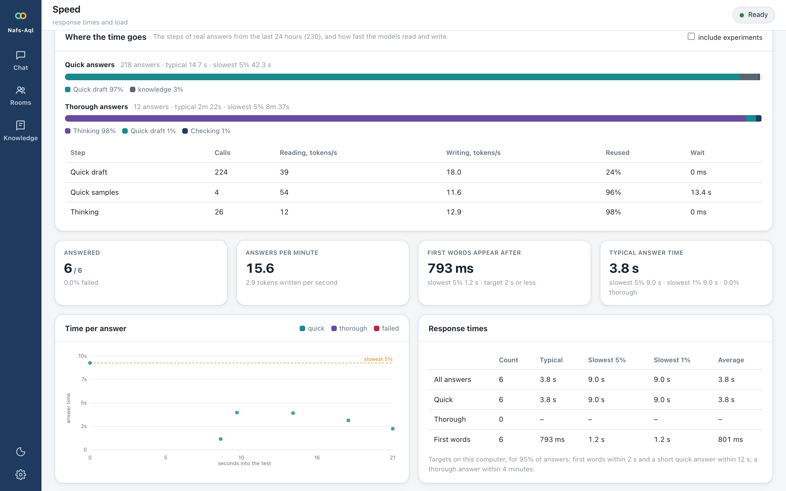
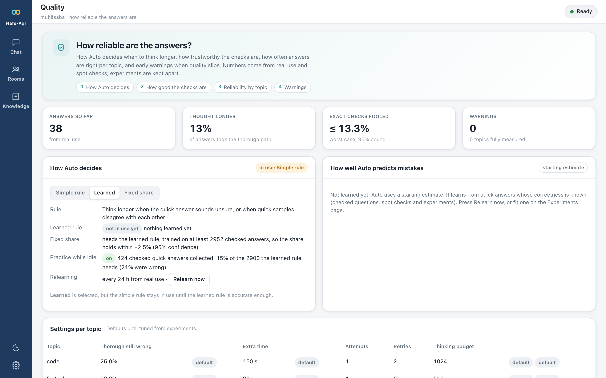
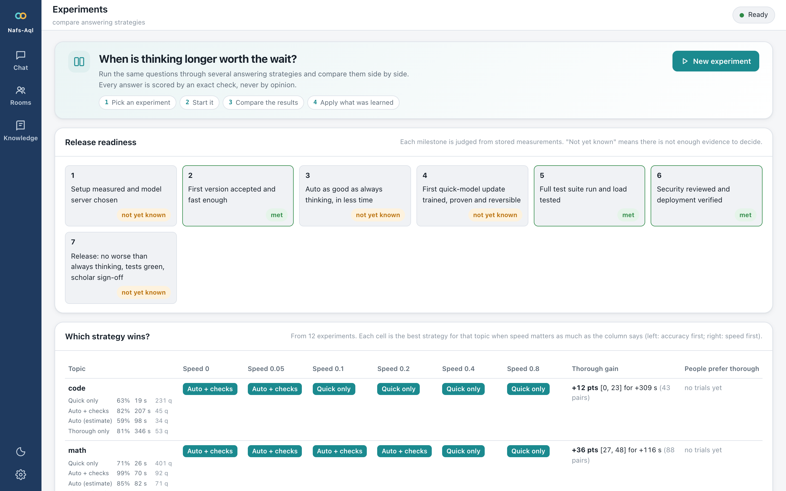
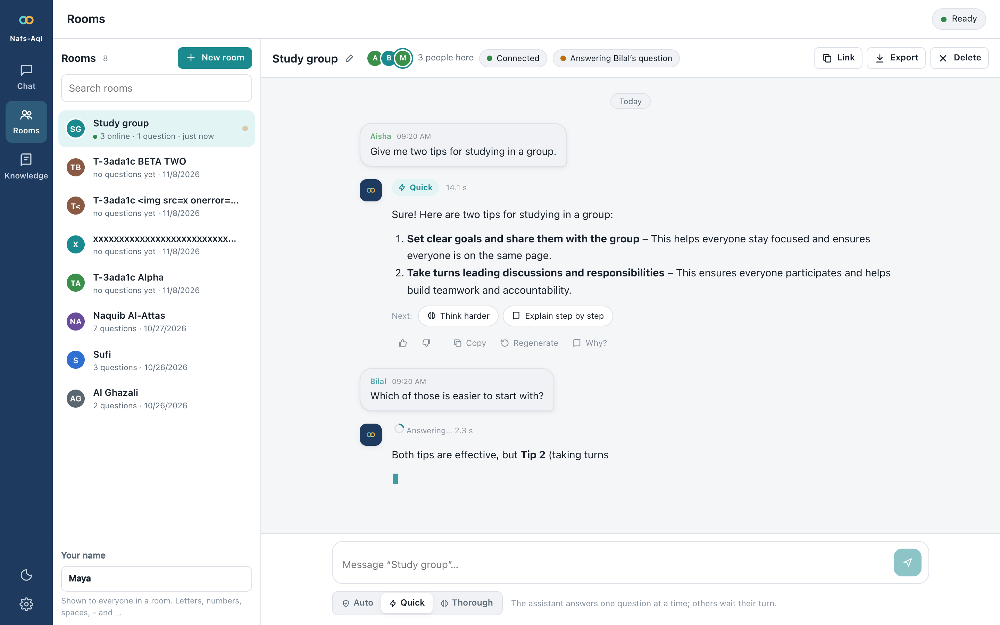
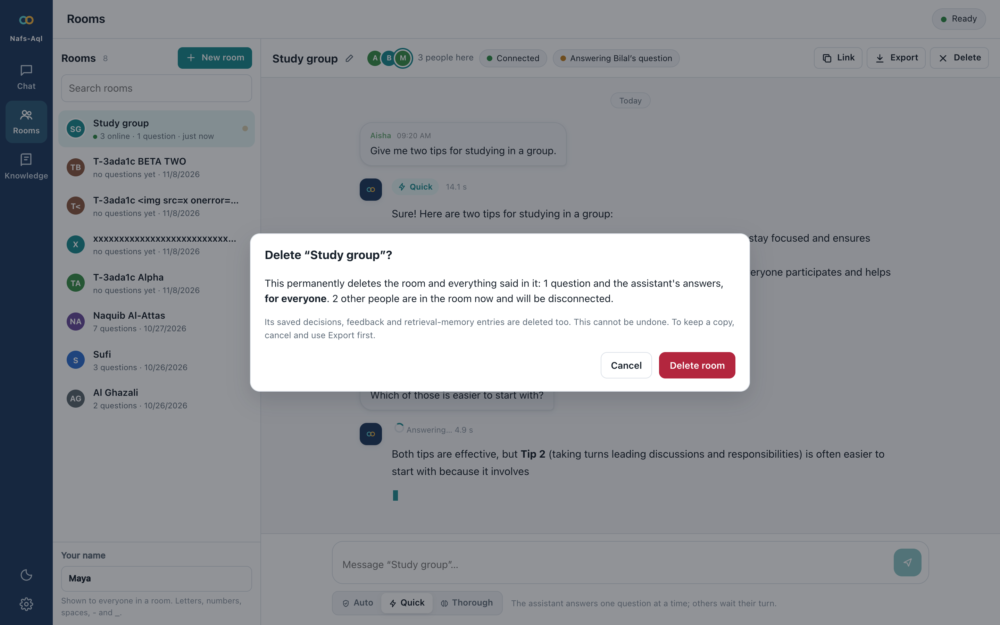

# Features and measured results

Everything the project has built and measured, phase by phase, with the evidence for each number. The [README](../README.md) is the short version.

## What is inside

| | |
|---|---|
| 🧠 **Aql Gate** | A threshold rule derived from a decision-theoretic model, with a fixed-rule mode, a held-out *calibrated* mode (promoted only if ECE ≤ 0.05) and a *budget* mode with a target escalation rate. Early escalation stops a doomed draft after 32 tokens. |
| ✅ **Verifier Hub** | Numeric and SymPy math, code tests in an OS sandbox (macOS `sandbox-exec`, Linux namespaces plus seccomp), JSON Schema. True- and false-accept rates are *measured* with a mutation harness and shown on every verdict. |
| ⏱ **Adaptive reasoning exit** | System 2's reasoning is probed for its answer at reflection points; on verifiable tasks the exact checker decides whether to stop. The final answer is still generated after the reasoning, as on the standard path. |
| 🔬 **Research lab in the browser** | Paired experiments with bootstrap CIs, exact McNemar tests and Bonferroni correction; a pooled *policy map* of the best System 1 / System 2 policy per domain and price of latency; human *Both* trials; resumable runs. |
| 📈 **Latency attribution** | Every reply records where its time went: queue, prefill, decode and KV-cache reuse per model stage, straight from llama-server's timings. |
| 🛡 **Operations built in** | Drift monitor (CUSUM with a shuffled negative control), alerts with a drill mode, Prometheus metrics, audit stream, retention purge, secure-by-default bind, token auth, TLS recipes. |
| 🔁 **Distillation loop (Tazkiya)** | Verified System 2 traces become System 1 training data under a promotion gate with one-command rollback. The GPU training run itself is deferred. |
| 👥 **Rooms** | Shared chats over WebSocket: everyone sees each question and the assistant's answer as it is written. Create, rename, search, share a link, export, and delete for good (the room, its messages and every ledger row made from it, in one transaction). Presence, typing, a queue of assistant turns, unique display names, automatic reconnection, and a join snapshot that delivers every turn exactly once however late you arrive. |
| 🧭 **Sequential evidence (Phase 8)** | The rules that read a *stream* of evidence come from sequential analysis and decision neuroscience: a lowest-window confidence signal whose early crossing *is* the full-draft decision (a running minimum), a posterior stopping rule with a collapsing bound for the adaptive exit, Wald's bound on what an early escalation can promise, and the optimal probe interval. A review of quantum theories of consciousness is included as a negative result, with the test each idea failed. |
| 🧮 **Math and code harness (Phase 10)** | Mechanisms taken from two open agent harnesses, as pure Rust in `nafs-harness`. From [Open Math Harness](https://github.com/openmathmodel/open-math-harness): **Lean 4 as an exact verifier** under its frozen-statement protocol (no `sorry`, no axioms, the elaborated type must match), and **best-first repair** over a tree of candidates scored by the verifier, with per-assert credit on code. From [OpenAI Codex](https://github.com/openai/codex): **`apply_patch` repairs** with its fuzzy matcher, head-and-tail evidence, and a **code agent** (`POST /v1/harness/code`) that patches and runs its workspace in the sandbox and stops only when the hidden tests pass. |
| 🤖 **Codex-style agent harness (Phase 11)** | The code agent's loop rebuilt on the mechanisms of Codex's agent core, adapted to a 1.7B/4B model on four CPU cores: an **append-only transcript** so llama-server's prompt cache reuses every earlier exchange (a cold 1,969-token prompt prefilled in 64 s, the same prompt plus one exchange in 3 s), harness-written **compaction**, Codex's `apply_patch` grammar as a **per-step GBNF grammar** that keeps the reasoning span free and stops decoding at the end of the action, a **whole-file edit policy** for short files, budget reminders, the run's cap enforced inside a model call, and the run's net diff. |
| ⚡ **Parallel inference on four cores (Phase 13)** | Measured first, then built where it pays: llama-server batches 4 streams at **2.3–2.7×** the tokens per second at short context but only **1.5×** at the 1,600 tokens of a repair prompt. So the cores are used *before* the expensive model: agreement samples share the draft's batch (**−24 %** time to the gate's decision), a failed draft gets 4 concurrent System 1 samples, each verified as it finishes, before System 2 is used, and rounds go out as one request with `n` choices so the prompt is prefilled once. Hedged candidates on System 2 are implemented and **off**: they did not pay. System 2 has 4 slots. |
| 🪜 **Engine knobs, the model switch, a cascade in the harness (Phase 14)** | Measured on the reference machine: the engine's own flags (flash attention, micro-batch, threads, polling) were **inconclusive on a shared host** and stay unchanged; co-scheduling the two servers showed **nothing to arbitrate** on four cores (the pair writes 7.1–7.8 tokens/s in every variant); the switch from System 1 to System 2 inside a request costs **about 1.5 s** and no System 1 slot survives the decision. Built: a **cascade in the code agent** (four System 1 candidates in one request, each judged by the exact verifier; System 2 only when none passes: **−26 % wall time**, six of ten tasks never reach System 2), **retries with Codex's backoff**, and a **warm-first backend switch** (the new pair is primed before the atomic swap). |
| 🦀 **Smiley Core, the Rust engine, as the default backend (Phase 15)** | The owner's Rust CPU engine is vendored into the workspace and served behind the gateway as a third backend. Measured against llama.cpp: **1.13× decode** on both models alone and **131 s vs 303 s** for twelve checked prompts through the whole gateway (9/9 on both, faster in 10 of 12), so it is the **default** (`make up`); llama.cpp stays one command away (`make up-llama`) for several concurrent users, since Smiley Core decodes one stream per model. A hardening fix came out of it: the code agent now accepts a patch that omits its `*** Begin Patch` line. |
| 🧭 **The code agent against modern harnesses (Phase 16)** | Research on SWE-agent, Agentless, observation masking, Anthropic's context engineering, Gemini CLI, Claude Code and DeepSeek-V3.2 against the agent's loop. Built what mattered on four CPU cores: a **compile check before the verifier** (an edit that does not compile is refused, with the error and the lines around it, and costs no verifier run), **rollback to the best version**, a **stall guard** that nudges on the second identical failure and ends the run as `stuck` on the fourth, and **caller guidelines** (the AGENTS.md / CLAUDE.md / GEMINI.md role). Measured interleaved over ten tasks on both models: **no change in verified count, calls or time** (the check costs 37 ms per edit); the guards are justified by the research and by a 900 s run lost to repeated `IndentationError`s, and the A/B found and fixed a stall-guard blind spot. Not closed, with reasons: self-generated tests, reasoning persistence, sub-agents. |
| ⚙️ **Smiley Core's speed, the model switch, the harness's cost (Phase 17)** | The engine is within **60-95 % of the machine's memory bandwidth** (measured ceiling 19.5 GB/s), so the gains were in repeated work, not in more parallelism. **Three decode threads beat four** on this shared host (+4 % / +8 %; six of six interleaved pairs). A **prefix store** keeps finished conversations' caches and restores the longest shared beginning: switching between chat, agent and arithmetic prompts fell from **5.8 s (System 1) and 14 s (System 2) of prefill to 0.1 s and 0.2 s**, equal to llama.cpp's slots, with **byte-identical** answers. The reasoning budget's continuation had been **re-prefilling the reasoning it had just computed** (a stray newline broke the cache match): now 5 tokens, 0.2 s; cold prefill per escalated request −70 %, mean request time 182 s → 133 s. The System 1 → System 2 handoff is 0.08 s of gate time and 0.4-1.4 s to the first reasoning token, with nothing to freeze. The harness's guards cost nothing (compile check 37 ms). |
| 👥 **Smiley Core serves several users at once (Phase 18)** | vLLM's serving design read from source, then built in Rust where it pays on four cores: the forward pass now takes **a position and a cache per row**, so several users share one read of the weights; a scheduler with slots, **chunked prefill** and a **prefix store shared by every slot**; the server owns one engine thread instead of a session behind a mutex. Measured alone on the machine: **14.2 / 20.2 / 24.9 tok/s at 1 / 2 / 4 users** (it had no concurrency at all before), against llama.cpp's 14.4 / 14.4 / 32.4 — level at one, **1.40× at two**, behind at four. **Every user's text was identical to what they would have been told alone, at every concurrency**; llama.cpp's was not at four. The gateway still sends one request at a time: it reads `max_in_flight` as the `n`-choice width too, and this server refuses `n > 1`, so that is the next small step. Not claimed: parity with vLLM, which does not run on this machine. |
| 🔄 **Smiley Core updated, LittleBit integrated (Phase 19)** | The owner's new engine (06c2b88: grouped attention, rotated int8 KV, position-keyed sampling) is merged into the vendored copy with every Nafs-Aql addition re-applied; **370 tests pass in release mode** and every live suite passes again (contract, security 26/26, Rooms 59/59, end-to-end 65/65, harness 53/53, acceptance 9/9). **LittleBit** (1-bit-class weights, `--littlebit`) is integrated and measured honestly: Qwen3-1.7B at 0.98 bits per weight (4.9× smaller) answers **0 of 12** exact-answer prompts against **9** for the dense model, so it is **off by default** until trained factors exist; the weights in use are shown on the Status page. The integration also exposed and fixed a **fourfold decode slowdown** (4.5 → 19 tok/s) that came from the compiler no longer inlining `array::from_fn` in an unchanged kernel; old and new engine now decode alike (18.7 vs 19.2 tok/s) and answer alike. |
| 📚 **Knowledge Base (Phase 20, in progress)** | Upload PDF, Word, PowerPoint, LaTeX, web pages, Markdown and text; Nafs-Aql reads them into passages in **SurrealDB** with full-text and vector indexes (Qwen3-Embedding-0.6B on Smiley Core), searches them by words, meaning or both, and answers chat questions from them with numbered sources. A knowledge graph (entities and relations read by the quick model, grounded in the passages) adds GraphRAG to chat and a browsable graph to the page. Next: **Memorilla** memory tokens. Pure-Rust parsers, a CBOR client, one document read at a time. Plan and specification: `docs/prompts/MEMORILLA_KB_PROMPT.md`, `docs/spec/knowledge_base_spec.md`. |
| 🕸 **Retrieval and graph upgrade after OntoSmith (Phase 21)** | OntoSmith read in full against our knowledge base. Built: the graph as a **rank-fused arm** rather than a sort (which explained a measured regression of our own), contextual BM25 with a context line that costs no extra model call, a **sentence packer** that fills the prompt with whole sentences, the ontology as editable data, **verified quotes** (a relation is kept only with the sentence that states it, found in the passage word for word), a **two-hop walk** with a path score, and named arms on every reply. Swept live on the project's own paper (PDF, LaTeX and Markdown), which found and fixed PDF ligatures, LaTeX escapes in the extraction and a stalled ingestion queue. See `docs/research/ontosmith_comparison.md`. |
| 🛡 **Hardened knowledge base and retrieval at scale (Phase 23)** | Uploads are streamed, capped and gated; a hostile zip, web page or PDF ends as a document error; deleting a base stops its training, forgets its caches and removes its passages from the stored replies (a 36-check security sweep passes). A base of 1,000 documents and 50,000 passages stays usable: search by meaning takes **0.37 s** through the store's index (22 ms from an optional in-memory copy), listing and counting take under half a second, and a words search takes a few seconds under load. Retrieval was tuned on 70 questions: the meaning arm is weighted 0.1 in the fusion, strong word matches are kept, common words are left out of a words search; model-written query expansion, near-duplicate removal and a reranker were measured and not adopted. The label stream collects verified drafts while the machine is idle, toward the 2,900 the calibrated gate needs. |
| 📊 **Measured against Semantic Router and DeepSeek Harness (Phase 24)** | Their own benchmarks, run beside ours on the same loaded 4-core machine: a per-request routing signal costs 2.2 µs against 198 µs, cutting a 16K-token text to a budget takes 9 ms against 50 ms, the agent loop's host overhead is 1.75 ms against a 900 ms budget, and their hand-written AVX2 dot product is still 1.3 to 1.5x faster than ours (at most 0.2 % of a vector query). The gaps that were real were closed (a faster packer, an AVX2 kernel); a stronger embedder, trained jailbreak classifiers and an Envoy filter were measured or weighed and not adopted. |
| 🚦 **The gate and the harness against vLLM Semantic Router and DeepSeek Harness (Phase 22)** | Both read in full. We were already ahead on what decides correctness (an expected-loss gate with a priced λ, exact verifiers, rollback, a stall guard, a sandbox); we copied the pure mechanisms: **certified per-bin risk** (a draft is kept only in a calibration bin whose Clopper–Pearson error bound is within `max_risk`), **a declared unknown policy** when a feature is missing, **reask** detection, a **polarity guard** on retrieval memory, and in the harness an **anchored token meter**, **prune-then-compact**, **no edit from a reply cut at the budget**, and a **repeat notice**. See `docs/research/router_harness_comparison.md` and decision 015. |
| 🔌 **Three serving profiles** | llama.cpp on bare metal (the reference), vLLM's CPU backend in Docker, and **Smiley Core**, the project owner's own Rust CPU engine (vendored in `rust/crates/smiley-core`, served by `nafs-smiley-server`), behind one OpenAI-compatible gateway; the switch between them is warm-first. |

<table>
<tr>
<td width="50%"> <b>Lab.</b> Which policy wins, per domain and price of latency.</td>
<td width="50%"> <b>Performance.</b> Where every second goes, with prefill, decode and cache reuse.</td>
</tr>
<tr>
<td width="50%"> <b>Muhasaba.</b> Drift per domain, alert rules over live traffic.</td>
<td width="50%"> <b>Gates.</b> Go / no-go computed from stored runs, never typed in by hand.</td>
</tr>
<tr>
<td width="50%"> <b>Rooms.</b> Presence, per-person bubbles, live answers, search and unread markers.</td>
<td width="50%"> <b>Delete.</b> A room can be deleted for good; the dialog says what is lost.</td>
</tr>
</table>

## Measured results

> **Read this first.** All numbers come from one Intel Core i3-8100 (4 cores, AVX2, 32 GB) that was *shared* with other workloads (load average 5–40), with tens of items per comparison. They show direction, not release-grade statistics; absolute speeds are lower bounds. Each figure is generated from stored runs (`benchmarks/`, `docs/publication/`), and the release gates need 700–6,200 paired items.

**What worked**

| Change | Effect | Evidence |
|---|---|---|
| Gate with the exact verifier visible, vs always deliberating | Same accuracy (6/6 each) at **36 % of the cost** | Lab run on 6 mixed tasks |
| Adaptive reasoning exit (System 2) | **−52 % reasoning tokens, −44 % mean time**, 11/11 correct in both arms | paired run, 12 GSM8K items |
| Cheap samples only when the draft is uncertain | Factual fast path **12.6 s → 4.3 s** median; first token 1.37 s → 0.14 s | `benchmarks/samples_ab_factual.json` |
| Skip samples when an exact verifier decides | Draft median **13.4 s → 7.9 s** | `benchmarks/reference-machine/samples_skip_ab_SHARED_MACHINE.txt` |
| Early escalation of unconfident drafts | 100 % agreement with full-draft decisions on 40 prompts; ~116 tokens saved per early escalation | `benchmarks/early_escalation_study.json` |
| Prompt-cache and verifier warm-up | First token 9.8 s → ~1 s; first verification 0.45 s → 3 ms | `docs/roadmap/STATUS.md` |
| Agreement samples on unverified math drafts (Phase 8) | wrong drafts flagged with AUROC **0.76** (token confidence 0.56–0.65); "any disagreement" catches **8 of 12** wrong drafts at 25 % escalation, expected accuracy **0.80 → 0.91–0.93** | `benchmarks/confidence_signal_study.json` (60 drafts with samples) |
| Agreement samples drawn **with** the draft, not after it (Phase 13) | time to the gate's decision **23.1 s → 17.9 s (−24 %)**, faster in 23 of 28 pairs (p = 0.0005); escalation 7 vs 5 of 28 (noise) | `benchmarks/fuse_ab.json` |
| Four System 1 samples verified before a failed draft is escalated (Phase 13) | 22 → 20 escalations over 40 items (3 avoided, 1 the other way); **+14.5 s median** when it runs, break-even 106 s against 250–580 s per escalation; 6 of 32 failed drafts rescued offline | `benchmarks/rescue_ab.json`, `s1_rescue.json` |
| One request with `n` choices instead of `n` requests (Phase 13) | 703-token prompt: **39.1 s vs 124.5 s** for four candidates (the prompt is prefilled once) | `benchmarks/prefill_share.json` |
| A cascade in the code agent: four System 1 candidates judged first, System 2 only when none passes (Phase 14) | 10 tasks interleaved: 10/10 verified in both arms, **1,467 s vs 1,987 s (−26 %)**, faster in 7 of 10 pairs (p = 0.17), 6 of 10 verified by System 1 alone (median 34 s vs 85 s) | `benchmarks/harness_ab_cascade.json` |
| The switch inside a request, System 1 to System 2 (Phase 14) | decision to System 2's first token **1.1–4.7 s** (median 1.5 s); gate 0.8–0.9 s without the rescue; no System 1 slot busy after the decision | `benchmarks/handoff_latency.json` |
| Engine flags and co-scheduling (Phase 14) | flag matrix inconclusive on a shared host (per-round ratios 0.07×–3.8×); both servers decoding keep 47–65 % each and write 7.1–7.8 tokens/s together in every variant | `benchmarks/engine_tuning.json`, `cosched_ab.json` |
| Smiley Core vs llama.cpp, engine alone and through the gateway (Phase 15) | decode 14.3 vs 12.6 (System 1) and 7.4 vs 6.6 (System 2) tokens/s; 12 prompts 131 s vs 303 s, 9/9 checked on both, Smiley Core faster in 10 of 12 pairs (p = 0.02, median 1.59×); shared host | `benchmarks/smiley_ab.json`, `benchmarks/backend_ab.json` |
| The code agent's new guards, off against on (Phase 16) | 10 tasks interleaved: System 2 **10/10 vs 10/10** (747 s vs 772 s), System 1 **4/10 vs 4/10** and **5/10 vs 5/10** in two rounds (307 s vs 297 s, 350 s vs 347 s); the compile check costs **37 ms** per edit; the guards fired once in 60 runs | `benchmarks/harness_ab_p16*.json` |
| Switching between kinds of request, before and after the prefix store (Phase 17) | agent prompt after a chat prompt: **266 tokens, 5.8 s → 1 token, 0.1 s** (System 1); **262 tokens, 14.1 s → 1 token, 0.2 s** (System 2); llama.cpp's slots 0.1-0.2 s; answers byte-identical with the store on and off | `benchmarks/switch_cost.json` |
| Decode threads and the engine's phase split (Phase 17) | 3 threads beat 4 in 6 of 6 pairs (System 1 11.3 vs 10.8, System 2 5.0 vs 4.6 tok/s); memory ceiling 12.9 / 17.2 / 18.4 / 19.5 GB/s at 1-4 threads; matmul + head 86-97 % of decode, sampling 0.1-0.3 % | `benchmarks/engine_profile.json`, `scripts/membw.c` |
| The reasoning continuation, before and after the exact prefix (Phase 17) | six escalated requests: cold prefill **700-1,160 → 350-390 tokens** (45-78 s → 22-24 s); mean request **182 s → 133 s** | `benchmarks/handoff_latency_smiley*.json` |
| Concurrent users, Smiley Core against llama.cpp (Phase 18) | each engine alone, 2 rounds, long answers: **14.2 / 20.2 / 24.9** vs **14.4 / 14.4 / 32.4** tok/s at 1 / 2 / 4 users; answers identical to solo **4/4** vs **0/4** at four users; engine primitive 1.56× / 2.57× / 2.27× at 2 / 4 / 8 rows | `benchmarks/concurrency_ab.json`, `examples/batch_bench.rs` |
| The engine update and LittleBit (Phase 19) | decode 18.7 (previous) vs 19.2 (new) tok/s, median of five interleaved rounds; exact-answer prompts 9/12 on both; LittleBit at 0.98 bpw 0/12 vs dense 9/12, 20.1 tok/s; Q4_K kernel 679 → 96 ns per row after the inlining fix | `benchmarks/engine_update_ab.json`, `benchmarks/littlebit_ab.json`, `examples/kbench.rs` |

**Verifier quality** (true-accept *r*, false-accept φ with 95 % upper bound)

| Verifier | Correct / mutants | r | φ (upper) |
|---|---|---|---|
| Math (numeric + SymPy) | 2,000 / 2,800 | 1.000 | 0.000 (≤ 0.001) |
| JSON Schema | 24 / 53 | 1.000 | 0.000 (≤ 0.067) |
| Code tests, EvalPlus | 364 / 754 | 0.995 | 0.109 (≤ 0.133)¹ |
| Rubric judge (System 2) | 23 / 22 | 1.000 | 0.045 (≤ 0.23) |

¹ An upper bound inflated by behaviourally equivalent mutants that also pass the far larger EvalPlus suites.

**What we tried and did *not* adopt** (kept in the repo, because a negative result is a result)

| Idea | Measured | Verdict |
|---|---|---|
| EAGLE-3 speculative heads (both models) | 1.04× / 0.99× decode at ~50 % acceptance; 8 draft tokens slower | verifying drafts costs real compute on 4 cores; opt-in only |
| Draft-model and n-gram speculative decoding | 6.5 vs 7.3 tok/s | not adopted |
| Flash attention, q8_0 KV cache, thread polling | no difference once runs were interleaved | a sequential run had shown a fake 30 % gain |
| Q4_0 / IQ4_NL repacked weights | 17–18 vs 18.8 tok/s | Q4_K_M stays |
| System 1 as the rubric judge | false-accept 0.27 vs 0.045 | a judge that accepts a quarter of wrong answers is not a verifier |
| Qwen3.5-2B as System 1 | **+17 points** accuracy (95 % CI +7 to +30, n = 30) but **3.7× slower** | adoption rule allows ≤ 1.3×; revisit on a faster host |
| Token-confidence escalation on unverified math (Phase 8) | best signal (lowest token) AUROC 0.65, lowest-window 0.58 on 150 drafts with exact labels; precision ≤ 0.47 against the 0.65 the gate's theorem needs at the default price | mechanism kept (exact, tested), threshold off; the study also showed the mean-log-prob rule escalates **0 of 31** wrong math drafts |
| Posterior exit rule for non-verifiable deliberation (Phase 8) | same answers on 6 factual prompts, **382 vs 357** reasoning tokens (more cautious when probes disagree first) | an option, not the default: `benchmarks/exit_rule_run.json` |
| A sequential test on the mean-log-prob early escalation | Wald's bound: ≥ 260 tokens to separate the threshold from its 0.04 margin at 5 % error; drafts are 47–291 tokens | kept as a measured heuristic, never made more aggressive |
| Quantum-consciousness mechanisms (Orch OR and descendants) | decoherence 10⁻¹³ s against 10⁻³ s dynamics; a CPU can follow at most ~30 two-level systems | nothing transfers as an algorithm; negative result, `docs/research/quantum_neuro_review.md` |
| Concurrent hedged candidates on System 2 (Phase 13) | batched decode gain falls from **2.7× to 1.5×** between short context and 1,600 tokens, so a round of four costs 2.2–3.4 single attempts; 8 hard code items: 4/8 and 3/8 verified by the sequential loop (two runs) against 4/8 hedged, no faster on failing items | implemented and tested, **off by default** (`deliberation.parallel`): `benchmarks/parallel_ab.json`, `batch_scaling_system2_depth*.json` |
| n-gram self-speculation (llama.cpp `ngram-simple`, `-map-k`, `-mod`) | best **1.12×** (code repair, 71 % of drafts accepted), worst **0.84×** (JSON) | not adopted: `benchmarks/ngram_ab_system1.json` |
| q8_0 KV cache with flash attention, for batched decode | 6.36 vs 6.14 tok/s at 1,600 tokens; worse at 800 | f16 cache stays: `benchmarks/batch_scaling_system2_kvq8_*.json` |

**Quality of the build** (final validation run, 31 October 2026, one quiet host; `benchmarks/harness_sweep.json`, `benchmarks/e2e_sweep.json`):

| Suite | Result |
|---|---|
| Rust unit and integration tests (nine crates, real Lean 4.35.0 included) | **206 / 206** |
| 9 Python tests, `clippy -D warnings`, `rustfmt` | clean |
| Security probes (`scripts/security_tests.py`; one real sandbox escape found and fixed earlier) | **26 / 26**, 0 open high findings |
| End-to-end sweep over every endpoint and UI page, incl. phone-width layout (`scripts/e2e_sweep.py`) | **65 / 65** |
| Rooms with simulated members (`scripts/rooms_test.py`) | **59 / 59** |
| Math and code harness sweep: real Lean, 6 attacks, code credit, validation, code agent, rescue, parallel settings (`scripts/harness_sweep.py`) | **50 / 50** |
| MVP acceptance A1–A9 (`scripts/mvp_acceptance.py`) | **9 / 9** (slow path 49 s against the 240 s target; A5's call bound includes the rescue samples) |

The sweep found and fixed three defects in the Lean integration (an inconsistent 400 between `/v1/chat` and `/v1/verify`, Lean tasks classified as open questions with no retries, and a prompt that did not say Mathlib is absent). **One honest limit it exposed:** Qwen3-4B-Thinking (4-bit, CPU) cannot yet write valid Lean 4, even for `n + 0 = n`, so Lean tasks end in a labelled *abstain* unless a stronger prover is used. The Lean verifier itself is exact: it accepts real proofs and rejects a hidden `sorryAx`, a user axiom, `native_decide`, `#eval`, a changed statement and a shadowed `HAdd` instance.

