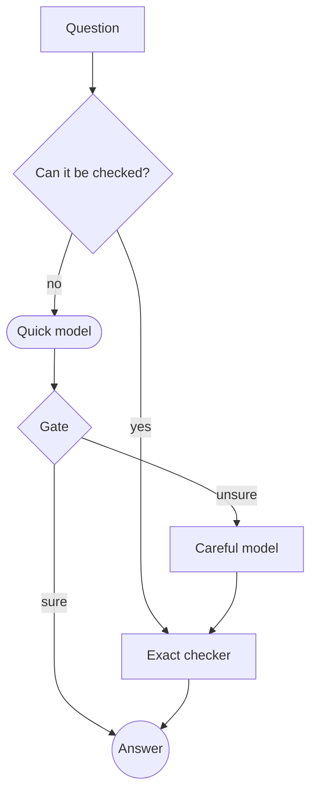
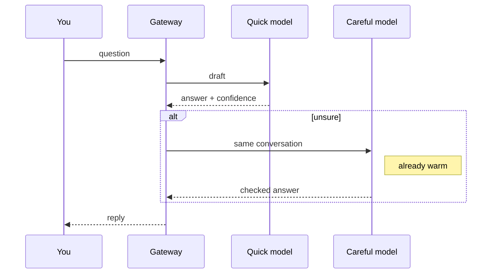
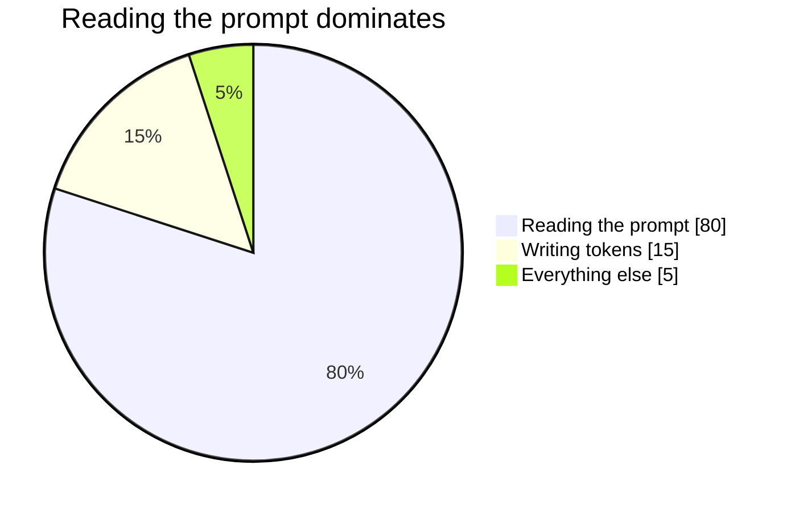

## Comparing the two models

Here is how the **quick** and **careful** models differ on this machine. *Numbers are medians* of three runs.

| Model | Size | Decode (tok/s) | Prompt read (tok/s) | Best for |
|:--|--:|--:|--:|:--|
| Quick | 1.7B | 15.5 | 94.1 | everyday questions |
| Careful | 4B | 6.7 | 38.2 | `hard` problems and proofs |
| Embedder | 0.6B | – | 180.6 | search by meaning |

> [!tip]
> A switch costs one prompt read. With the shadow it is about 2 s instead of 37 s.

### How a question is routed



### The gate in one line

The gate escalates when the expected loss of a wrong answer, $p \cdot L$, exceeds the cost $c$ of thinking:

$$\text{escalate} \iff \hat p(x)\,L > c, \qquad \hat p = \sigma\!\left(\sum_{i=1}^{n} w_i f_i(x) + b\right)$$

and the precision of a verified answer is bounded by $\frac{r}{r+\phi\,(1-\pi)/\pi}$.

\[ \mathrm{softmax}(z)_j = \frac{e^{z_j}}{\sum_{k=1}^{K} e^{z_k}}, \quad A = \begin{pmatrix} 1 & 2 \\ 3 & 4 \end{pmatrix} \]

### A small helper

```python
def escalate(p_wrong: float, loss: float, cost: float) -> bool:
    """Think longer only when it is worth the wait."""
    # expected loss of keeping the quick answer
    return p_wrong * loss > cost
```

```rust
fn rank(scores: &[f32]) -> Vec<usize> {
    let mut ix: Vec<usize> = (0..scores.len()).collect();
    ix.sort_by(|&a, &b| scores[b].total_cmp(&scores[a]));
    ix
}
```

### Sequence of a switch



### Where the time goes



- [x] Measured on one machine
- [ ] Measured on a larger one
  - nested point with `code`
1. First step
2. Second step

See the [paper](https://example.com/paper) [1] and the note [2].
